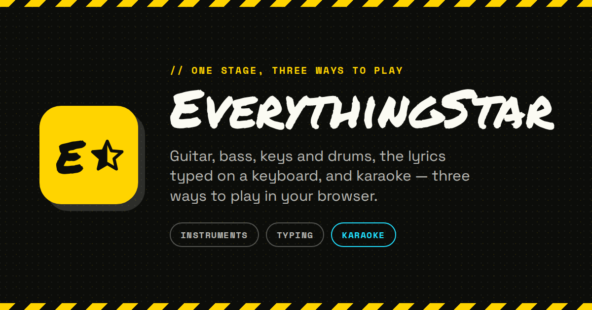
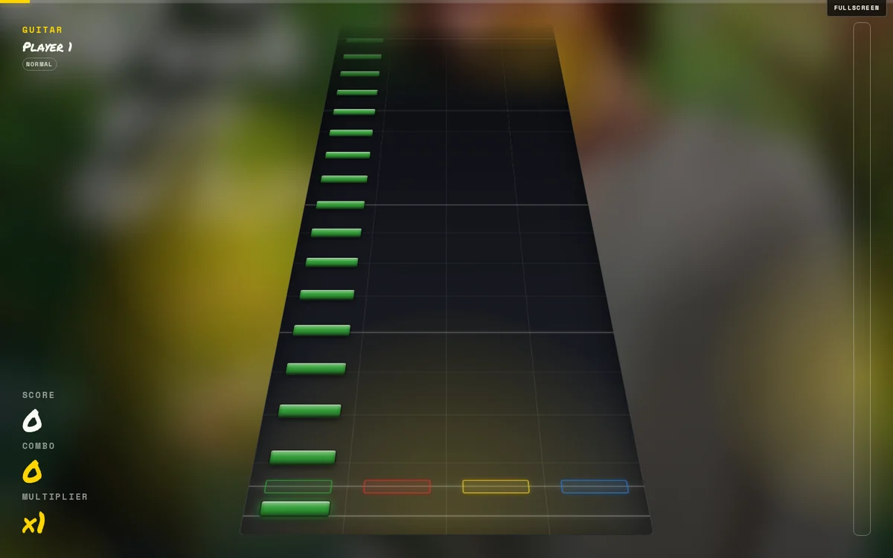
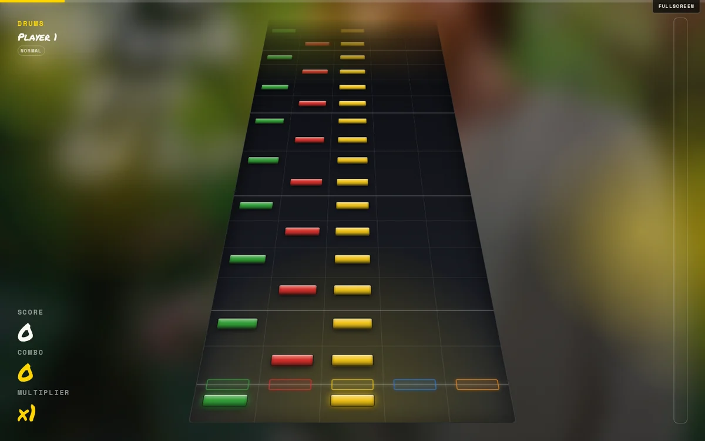
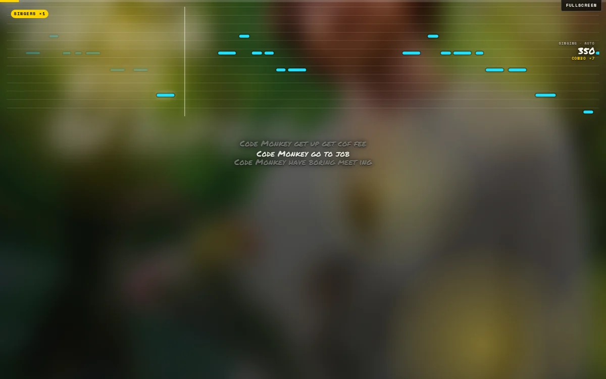
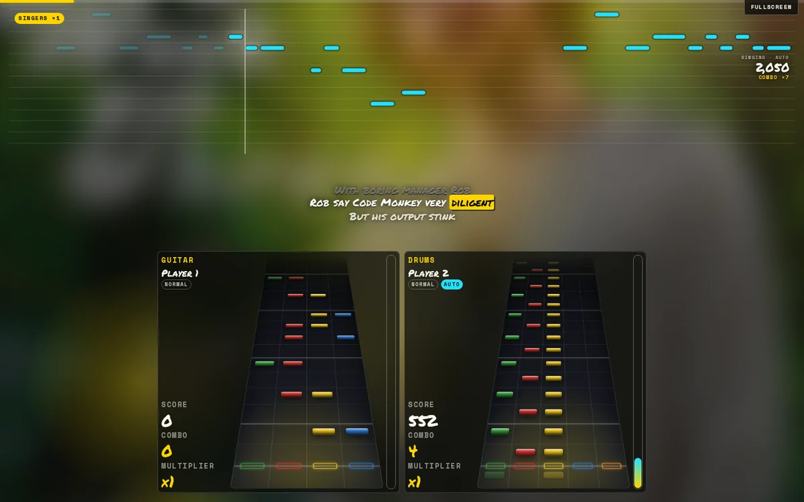
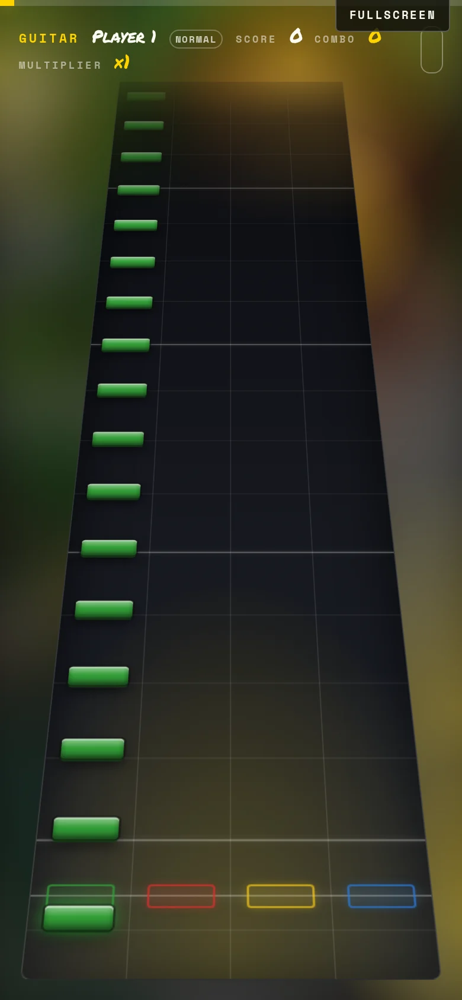
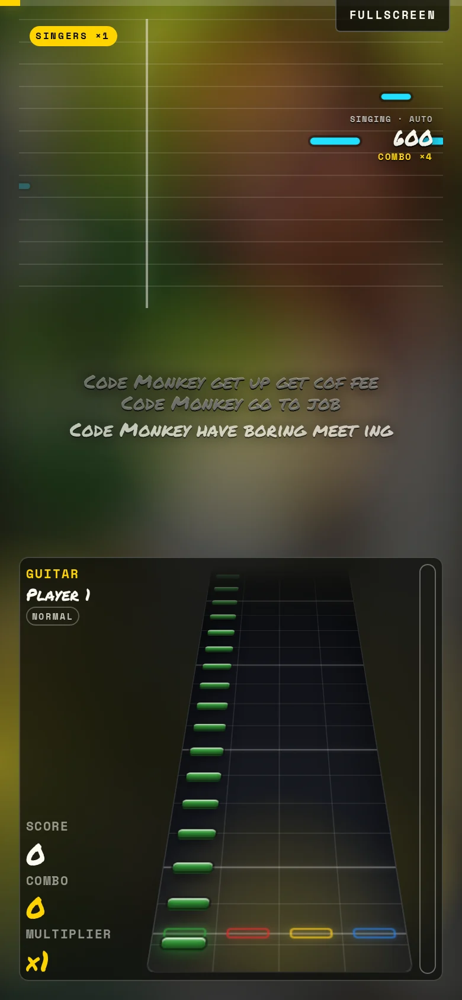
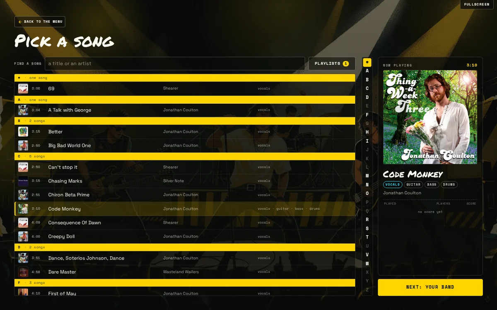
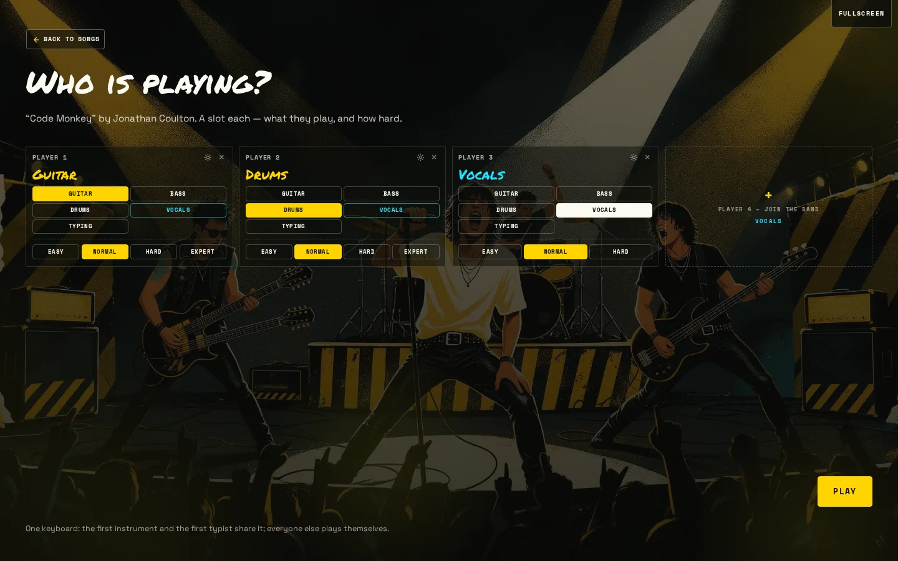

# EverythingStar

**Three ways to play on one stage, in your browser.** EverythingStar is a rhythm
game that puts instruments, lyric typing and karaoke together: guitar, bass, keys
and drums as falling notes; the words typed on a keyboard; and karaoke sung into a
microphone. Play it with a keyboard, a gamepad, a MIDI kit or a microphone — and on
a phone by tapping the notes instead of strumming.

**All three are built, including drum fills and a kick pedal.** The sound manifest is
complete too. What is left is scope: a leaderboard or a phone as a controller is a
separate project, not a missing mode. The honest list is below.

[](./LICENSE)

[](https://github.com/HappyPaul55/everythingstar/actions/workflows/ci.yml)
[](https://github.com/HappyPaul55/everythingstar/releases)

**[Play it at everythingstar.happypaul55.com](https://everythingstar.happypaul55.com)** —
free, no account, no cookies, no trackers, nothing to install. Install it from the
browser's menu if you would rather have it on your home screen, with its own icon and
offline play.

<p align="center">
  
</p>

What works today:

- **The whole loop, in one island.** Welcome → menu → jukebox → band → stage
  entrance → run → pause → results, with no page reloads and a fullscreen session kept
  across it.
- **An arcade that plays itself.** `/arcade` is a game-only entry: left alone for
  thirty seconds it chooses a song, builds a band, plays a perfect machine run and
  goes round again. Any input gives the welcome back. The same attract loop is the
  homepage's phone-shaped live window — one player and silent there, a band and sound
  in the full arcade. The window is a same-origin iframe, so `public/_headers` keeps
  `frame-ancestors 'self'` rather than `'none'`. The whole frame is a **link to
  `/play`**: the iframe is decoration (hidden from assistive tech, out of the tab
  order, taking no pointer events) and the anchor laid over it is the control — named
  "Play EverythingStar", keyboard-focusable, and outlined on hover and focus so the
  picture keeps its hit line, with the caption link below it kept.
- **The three ways to play.** Falling-note **instrument** lanes for guitar, bass, keys
  and drums (chords, hopos, sustains, whammy, judged per player); **Typing** with
  TypeStar's forgiving rules; **Vocals** into a microphone, judged on how much of each
  note's own span was held in tune. On a pitched song each words player chooses
  singing or typing.
- **Songs are fetched, not bundled.** The built-in library is the separate
  [EverythingStar FOSS](https://github.com/HappyPaul55/everythingstar-foss) playlist;
  any `http(s)` playlist can be added, a playlist can answer a search instead of
  listing songs, and a folder of charts can be opened from this machine or imported
  into the browser. Guitar Hero / YARG MIDI, Clone Hero `.chart`,
  UltraStar, StepMania, `.sng` packages and timed lyrics all read through the same
  parsers.
- **Real controllers.** Keyboard bound by key code, gamepad, MIDI keyboard or drum
  kit, microphone, and hit markers that are controls — so a phone can play. A mapping
  can be **learned** control by control, which is the only way a plastic guitar or a
  non-standard kit gets set up. The first notes of a run name the controls they need
  — the seat's own keys, pad buttons or MIDI notes, plus the strum — and the labels
  step aside after eight hits. The lesson is per player: Player 3 still gets it when
  Players 1 and 2 have already played.
- **A run plays the song.** Its own stems, streamed, with the clock taken from the
  sound; a missed note ducks that part to a tenth of its level until the next hit.
- **Local by design.** No server and no account: the band, the settings and the scores
  stay in this browser. The build is static files on Cloudflare's edge.
- **An installed game, not a tab.** The website is a PWA: install it from Options (or the
  browser's menu), and it opens without browser chrome, starts with no connection, and
  keeps the songs you download for offline play.
- **Links that add music.** `Open in EverythingStar`, `Add Playlist to EverythingStar` and
  `Add Song to EverythingStar` are one family of URLs; a phone with the Android app
  installed opens it instead of the browser. See [`DEEPLINKS.md`](DEEPLINKS.md).

## Screenshots

Every shot is the game itself — no mockups. The song is from the built-in
EverythingStar FOSS library. The desktop shots show the
stage in fullscreen (the site's header and footer stood aside, as they do there); the
phone shots are portrait at 390 × 844.

| | |
| --- | --- |
|  |  |
| **Single player — guitar.** Five columns, chords, hopos, sustains and the whammy, on the highway the note-view and note-style settings redraw. | **Single player — drums.** Drums are lanes too, drawn exactly like a guitar and judged by the same rules; only the mapping differs. |
|  |  |
| **Karaoke.** A piano roll with the words under its notes, each note a bar for as long as it is held. The microphone is judged on how much of that span was in tune — and nobody has to sing. | **A full band — guitar, drums and karaoke.** The melody sits on top and the lanes on the floor. Each player keeps their own score and difficulty; a words player chooses singing or typing. |
|  |  |
| **On a phone.** A lone highway takes the whole width, with the score and meter moved above it. The hit markers are controls, so a phone needs no keyboard. | **Guitar and karaoke on a phone**, the melody above the lane and the rails in reach. |
|  |  |
| **The jukebox.** A list you navigate: A–Z index, search, duration, artist and what each song offers, and the chosen song in the now-playing panel. | **The band screen.** One box per player — what they take, how hard, and the controller in their hands. |

## The three ways to play

| Way | Idea | Where it is |
| --- | --- | --- |
| **Instruments** | Guitar, bass, keys and drums as falling note lanes; chords, hopos, sustains and the whammy. | **built** — drums play the same highway, mapped to pads |
| **Typing** | The words on screen; type each word as it arrives (TypeStar-style). | **built** — on lyrics-only and pitched songs |
| **Vocals** | Karaoke: sing the words that light up, judged on how much of each note was held in tune. | **built** — YIN, judged per singer |

**One set of notes, played on anything.** The instrument way is guitar, bass, keys
and drums, and on a phone the pads are tapped instead of strummed — so there is
nothing to plug in. Drums carry their own **kick column** and **freestyle fills**,
and a full meter is spent on **star power** with the whammy.

What that leaves out is scope rather than a missing mode: **no leaderboard and no
server** — the band, the settings and the scores are this browser's — and the phone
as a controller is a separate networked project. The seven generated stings and the
four recorded band entrances are files that can be replaced one at a time.
The complete list, with the reason for each boundary, is under
[Status](#status-what-is-built-and-where-it-stops).

## Contents

- [Screenshots](#screenshots)
- [The three ways to play](#the-three-ways-to-play)
- [Install and offline](#install-and-offline)
- [Links into the game](#links-into-the-game)
- [Quick start](#quick-start)
- [Status: what is built, and where it stops](#status-what-is-built-and-where-it-stops)
- [The loop around a run](#the-loop-around-a-run)
- [Practice](#practice)
- [Libraries, scores and the band](#libraries-scores-and-the-band-local-for-now)
- [The stage](#the-stage)
- [How a highway is drawn](#how-a-highway-is-drawn) ·
  [how it plays](#how-a-highway-plays)
- [Dev tools](#dev-tools-not-the-product)
- [Stack](#stack) · [the first download](#the-first-download)
- [Commands](#commands) · [browser tests](#browser-tests)
- [Pages](#pages)
- [The fixture library](#the-fixture-library)
- [Design and accessibility](#design-and-accessibility-do-not-regress)
- [Project structure and key files](#project-structure-and-key-files)
- [Deployment](#deployment)
- [Contributing and security](#contributing-and-security)
- [Licence](#licence)

## Quick start

You need [Bun](https://bun.sh) — the version is pinned in `package.json`. Never
`npm` or `npx`; the lockfile is `bun.lock`.

```bash
git clone https://github.com/HappyPaul55/everythingstar.git
cd everythingstar
bun install
bun run dev        # http://localhost:4321
```

The landing page is `/`, the game is `/play`, and `/arcade` is the attract entry
(and the homepage's live window).

`bun run verify` is the gate every change has to pass: lint, knip, `astro check`,
the tests' typecheck, the unit tests, the build, the PWA gate and the size budget,
in that order. CI runs the same command. [Commands](#commands) lists each gate on its own, the
browser tests and the chart importer.

### Where the songs come from

No song ships in this repository. The built-in library is the published
[EverythingStar FOSS](https://github.com/HappyPaul55/everythingstar-foss) playlist,
fetched from its URL like any other source; the browser streams audio, caches the
documents (playlists, songs, charts) and keeps audio only when you press **Download**.

The game names only that one **default seed**; every other library — the sibling sites
included — is a third-party playlist added through the same generic contract. There is
no provider directory inside the game, and a site is not special because it is ours.

- **Add a playlist** from the jukebox's **Playlists** dialog: a full `http(s)` URL,
  and the dialog shows the host it will reach before it is added.
- **Link to a playlist or a song**: `…/open?playlist=…` or `…/open?song=…` adds it after
  one press. See [Links into the game](#links-into-the-game).
- **Open a folder** of charts from this machine, or **import files** into the browser
  on one that has no directory picker.
- **Convert a folder** into the three documents with
  `bun run import --from <charts> --to <library>`. Audio is referenced, not copied.
- **Build a provider**: [`PLAYLIST-API.md`](PLAYLIST-API.md) is the wire contract —
  the playlist, song and chart documents, the `?q=` search, CORS, timing and an
  acceptance checklist.

## Install and offline

The site is a **Progressive Web App**. It can be installed from the game's **Options**
page, or from the browser's own menu (on iPhone/iPad: Share → Add to Home Screen). The
manifest starts at `/app`, the game-only page, so an installed game opens without a
browser bar; `display_override` asks for fullscreen where the platform supports it.

A generated `/sw.js` is what makes it offline:

- the **shell** — `/app`, `/embed`, `/play`, `/open`, their chunks, fonts, icons, artwork,
  the small cues and the opening bed — is precached on install, so a cold start needs no
  network;
- a navigation is served from the cache immediately and refreshed in the background, so a
  deploy arrives on the next launch rather than making this one wait;
- the **downloaded songs** are served from `everythingstar-offline-v1`, which the game's
  own Download action fills and a media element reads with byte ranges. The worker never
  fills that cache itself: browsing is not a download;
- the other menu beds are cached the first time they are played, not at install.

The **Downloads** action now appears in the browser as well as the native app, and a saved
song plays with no connection. Nothing else is downloaded: a song's charts and audio are
still fetched only when a band plays it. `bun run check:pwa` checks the built manifest and
worker; `bun run test:pwa` installs the worker against a production build, cuts the network
and reloads `/app` to prove the shell starts.

## Links into the game

Three links use one family of URLs:

```
Open the game                 https://everythingstar.happypaul55.com/open
Add a playlist to it          /open?playlist=<percent-encoded playlist URL>
Add a song to it              /open?song=<percent-encoded song-document URL>
```

They are ordinary `https:` links, so they can be posted anywhere. On Android, a verified
App Link (or the `everythingstar://open?…` custom scheme) opens the native app instead of
the browser; without it the same URL opens the game, installed or in a tab.

**A link is an invitation, not a command.** The game removes the query from the address bar
as soon as it reads it, asks "Add this playlist? From example.com", and changes nothing
until **Add** is pressed. A link that arrives during a run waits until the run is over. The
target must be an absolute `http(s)` URL with CORS, no credentials, under 8 KB; a song link
is a song document (not a `.sng`), and a one-song playlist is the alternative for packages.

[`DEEPLINKS.md`](DEEPLINKS.md) is the full contract: the addresses, the trust rules, the
native hand-off (cold and warm launches), the `assetlinks.json` verification, and an
acceptance checklist. A playlist row's **Copy link** produces the canonical address.

## Status: what is built, and where it stops

### What works end to end today

- **The loop**: welcome → **menu** (with **options** and **credits** off it) → jukebox →
  band → loading → **stage entrance** → run → pause →
  results, inside one island (no reloads), with the band, the settings and the scores kept
  on this device and a fullscreen session surviving the whole thing.
- **The library**: songs come from **playlists** — JSON files at URLs, seeded once
  with **EverythingStar FOSS** and added by the player — read as the three documents a
  real library will
  serve (a playlist is the index, a song document is what a song is, a chart document is
  the notes), cached in IndexedDB under a shape version with a small metadata index
  beside each body, with a player's playlist re-fetched only on demand. A
  playlist can be **on demand**: the game asks it with `?q=` as the jukebox is searched.
  A song can also name a **YouTube video as its music** (`audio.source: "youtube"`): the
  official IFrame player supplies both the sound and the backdrop, and the stage follows
  its playhead. No stream is extracted or served. An entry can also point its `song` at a
  **`.sng` package**, which the game opens when the song is chosen.
- **Local imports**: a browser with no File System Access picker (Safari, Firefox) can
  still take **files or a folder**, through the Playlists dialog or a drop. The files are
  **copied into this browser's own storage** (the Origin Private File System, up to
  512 MB an import) and read by the same folder scanner, so the songs join the library
  beside the playlists — and are still there next visit, without a permission prompt.
- **Offline downloads** (website and native app): the jukebox can save a song — its
  playlist, song document, every chart, every stem, its art and preview — into Cache
  Storage, and the site's own `/sw.js` — or the app's worker — serves them back to media
  elements, byte ranges included, so the song plays with no connection. Both register a
  worker that serves the same `everythingstar-offline-v1` bucket, so the action appears in
  the browser too. A download is one **page-wide job** that keeps going if the player
  leaves the jukebox and can be **cancelled**; a song found through an on-demand search
  is still listed after a reload because the offline records are merged into the library
  last. YouTube-backed songs and songs already in a local folder are refused rather than
  half-saved. A whole **playlist** can be saved from the Playlists dialog with **Save
  playlist offline**: a cancellable queue over the same per-song records, which stops on
  a full device and leaves the songs it already kept.
- **The stage**: a song's charts are fetched for the band that is playing and judged per
  player; words can be sung into a microphone (YIN, judged on how much of each note's
  own span was held in tune) or typed (TypeStar's forgiving rules), with the choice
  made per player on pitched songs.
- **The three ways to play**: **Instruments** on guitar, bass, keys and drums (with
  the pads tapped instead of a strum bar on a phone, lead and rhythm guitars as
  separate seats, and a kick column plus freestyle fills on the drums), **Typing**,
  and **Vocals** (karaoke). All three are complete; the
  [status detail](#status-in-detail) lists the boundaries rather than missing modes.
- **Controllers**: the keyboard (bound by `code`, so a layout travels), a gamepad, a
  **MIDI** keyboard or electronic drum kit, and a mapping a player *learns* control by
  control — which is the only way a plastic guitar or a kit can be set up, since the
  guitars arrive as gamepads and a kit's pads are not standard. A MIDI seat is asked
  for permission only when its owner chooses MIDI or starts setting it up, never on
  load; notes are read in the page and nothing is sent anywhere. Its preset is a
  chromatic run from middle C, which a MIDI keyboard sends with no setup; a kit's
  pads are mapped in the gear. A **strum bar that reports as an axis** is learned like
  a button, and a **MIDI control change** (a hi-hat pedal, say) is mapped like a note.
  The **hit markers are
  controls too**: tapping one plays the note above it, with the tap carrying its own
  strum, so a phone with no keyboard or gamepad can play a highway. The pad is also the
  **menu cursor**: D-pad or left stick moves DOM focus, A selects, B goes back and Start
  pauses. Text fields stay the operating system's keyboard; the game never draws one.
- **Audio** (see **[`AUDIO.md`](AUDIO.md)** for the ids, the contract and the shopping list): menu
  music as a playlist per screen, a whoosh on every screen change, every button, a
  smaller cue when the pointer or focus moves onto a control, the
  typing feedback, **a preview when a song is picked**, a **quiet crowd while paused**,
  an **error when a player's channel goes out**, the combo milestone and hero
  sparkle, the score count-up and star power's spend,
  the **band's own entrance** (one per unique part, panned across the stage) —
  with a manifest, per-file measured trims and credits, four **streamed Ogg/Opus
  menu beds**, and a public-domain crowd loop for the pause. The **menu's** music
  ducks under a sting (the band's entrance is the deliberate exception) and a run's
  own stems never do: a cue is a sound beside the song, not a hand on its fader. The
  master has **music, ambience and sound
  effect families** of its own. Every type has a file; the six stings are a
  **generated chiptune first pass** (CC0) and the four `hype_*` entrances are CC0
  Freesound recordings, all replaceable file-for-file, and
  `AUDIO.md` carries the brief for commissioning better ones.
- **Backdrop**: the game's own artwork on the menus, the song's own video (or its art,
  blurred) on the stage, and drifting flares so the room is not a photograph — and
  whether a song's own plays at all is a **setting** rather than a rule.

The built-in index is read fresh once per visit; a browser seeded with the old local
`/playlist/default.json` is migrated onto it, and `src/lib/game/mock/` stays a
**fixture generator** for the tests.

### Status in detail

What is built in each area, and the boundaries that are deliberate rather than gaps.

**Audio — built**

- **The band loads the song, not the stage.** Opening the band starts the document,
  the charts and the stems; **Play** waits there until every stem the run will use
  reports `HAVE_ENOUGH_DATA` — the browser's "can play through" — and then goes
  straight to the entrance. The button reads **Loading…** with a file count while it
  waits, a failed stem is settled and named under the band, and a wait past 45s offers
  **Play anyway**. On a phone the stems are **primed** with a muted play, because
  `preload` is ignored there until a media element has been played. `StageDirector`
  repeats the readiness check before it starts the clock, so the paths that skip the
  band (the attract demo, a replay) cannot count down against silence either — and
  the same check is released by the player's **Play anyway**.
- **A song plays its own audio, and the clock follows it.** A run plays the `full` mix
  a song document names — **which file that is depends on the chart folder**: one that
  shipped a multitrack plays its parts, one of one or two instruments plays the master
  **and** its parts (the master is the mix with those instruments taken out, so on its
  own it is the song without its guitar). See `AGENTS.md`, and `mixPresetsFor` for the measurements. It is
  **streamed** through media
  elements rather than decoded (or read from Cache Storage when the song was downloaded),
  and the playhead *is* the sound: a frame loop counting
  milliseconds drifts against the music, so `StageClock.followSource` hands the clock to
  the audio and takes it back only when a song has none. Pause pauses the sound, resume
  picks it up, and the audio lag setting now moves the playhead against the sound the way
  it was always meant to. A song read from a folder has its stems read as files and handed
  over as object URLs, like its cover. The stems themselves are held in line **by a rate,
  and seated by one move at a start** (`src/lib/game/audio/drift.ts`: within 18ms alone,
  out of line nudged by at most 2% of speed, and a flam the room can hear — past 40ms —
  seeked once rather than trimmed for seconds; a start waits for every stem to actually
  move and seats them with a single alignment, because a `currentTime` write on a
  starting element restarts its startup; and a stem whose writes never land — a live
  stream — is never written to again, only carried) — and the clock is read from the
  sounding stem **closest to the playhead**, so neither a slow first file nor a part that
  resumed late can pin or drag the rest — while a stem that should be playing but is not
  is seated on the playhead and asked again rather than left silent, and an ended stem is
  never restarted. Every correction — the drift, a pause, a resume — targets the
  **playhead**, never whichever stem the clock happens to be reading, so a pause cannot
  come back with the band behind the notes.
- **A miss ducks the part out of the song.** A run plays `full`, and each part's own
  stems are **ducked while that part is out**: a missed guitar drops away to the
  backing and comes back on the next hit — the song document's own `audioControl`
  rule, read by `src/lib/game/audio/parts.ts` and published one way from the panel to
  `SongAudio`, which sets that element's volume to a **tenth of its own level**
  (`HELD_SHARE`) — never to nothing, because a media element at `volume = 0` leaves the
  browser's audio clock and comes back out of phase, and never `pause()`d, which would
  take it out of the drift as well. Nor is it ever pinned: a ducked stem is on the clock,
  so the ordinary rate rule carries it. The **master is never one of those stems**: it
  has no instrument, so a song shipped as a single file has no channel to drop out, and
  a miss cannot duck the whole song. A stem the run **never plays** — the guide vocal
  under a singer — is not loaded at all (`unplayedStems`), so there is no silent stream
  to keep in step. The registry is **per seat**, so
  two players on one instrument leave the stem down while either of them is out. The
  mapping follows the chart folder's names with one correction: a song with a **bass
  chart but no `bass.ogg`** gives its `rhythm.ogg` to the **bass part** (measured on a
  bass-led test song, that file is the bass), so a missed guitar note leaves the bass
  playing. The **`error` cue
  is the sound of that stop** — it plays the first time a part goes out (not on every
  miss), and on a one-master song it plays too: nothing actually ducks, but the part
  would have gone out.
- **Choosing a song plays it.** Moving onto a jukebox row, clicking it or pressing its
  confirmation key starts that song's **preview**: the chart folder's `preview.ogg`
  clip if it has one, otherwise its **master** from the song's own `previewStartMs` (`previewFor`). A
  song with only parts and no whole mix has nothing to preview — except a `.sng` package,
  whose first audio member is the only sound it has and is better than a silent row — and
  one with no audio at all says nothing. The preview streams through the mixer's **music**
  channel and **loops** until another row is chosen or the jukebox is left; a local file is
  read into an object URL and the previous one released. A **`.sng` package** is held for
  the rest of the visit in a bounded in-memory cache (two packages, 64 MB), so opening
  the band reads the same bytes rather than downloading the package again — a second
  reader in one visit, not persistence. The jukebox has no menu bed behind
  it, so a song with no preview is silent rather than playing the room's music.

**Audio — complete**

- **A miss ducks any player's part, not only a highway's.** A singer's or typist's
  miss now ducks the words' stems through the same `controlledStems` registry, and a
  lead and a rhythm guitar own their own stems instead of sharing one guitar channel.
  `onMiss.restore` is honoured: `next_hit` (the default) or `phrase_end`, which holds
  the part out until the phrase or lyric line it was dropped in has finished.
- **The pause has a crowd.** The mixer holds a bed per channel, so the ambience
  channel plays a public-domain room while the run waits, and nothing else asks for it;
  the jukebox's preview never stops it. There are no applause reactions — a run is the
  song, and the player's own stem is the feedback. The **Crowd** toggle in Options
  turns the pause's room off.
- **Music ducks under a sting.** The three channels have their own levels (Options:
  music, ambience, sound effects), the master sits above them, and a sting dips music
  and ambience rather than the master.
- **The band gets its own entrance.** The stage's first entrance plays one
  `hype_*` cue per unique part — three guitars are one guitar, a singer brings the
  microphone tap, a typist brings none — all starting together and panned evenly
  inside ±25% in band order. It does not duck the song: the entrance is the band
  starting, not a sting over the first bars, and a practice restart does not replay
  it. A run opens on a **quiet beat**: the song's background, the progress bar, the
  score rails and the meter are up first, while the highways and the words stay
  offscreen. Then the hype and the slide begin together — the highways rise from the
  floor, the words drop from the top — and the song waits for the lead, the hype/slide
  and a short breath. There is no 3-2-1 timer and no count tick any more.
- **The run's cues are all wired**: `sparkle` on a hero note, `tick` on the results
  score count-up, and `meter_activate` when a full meter is spent on star power — a lane
  player's whammy buys eight seconds of double score, on top of the combo multiplier.
  The gauge **filling** is silent: it is drawn on the rail, and a swell for it was a
  sound over the song rather than in it.
- **Every type has a file.** The six stings the game was waiting on —
  `win`, `fail`, `best`, `miss`, `type_miss` and `meter_activate` — are
  now a **generated chiptune first pass** (CC0, credited in the manifest), so no cue is
  silent; the four `hype_*` entrances are CC0 Freesound recordings. All of them are
  the part of the sound that is meant to be replaced: `AUDIO.md`
  is the brief, and a better file is a manifest entry rather than a code change. The
  **`error`** cue (`error_1`) remains the sound of a part going out — the first miss of
  a streak — including on a one-master song, where nothing actually ducks.
- **A cue never turns the song down.** The mixer's duck is the **menu bed's** own — a
  sting over `background` music — and a run's stems live outside that graph, so no miss,
  hero note or meter cue can lower the band. That is why `useAudioDucked` is gone rather
  than merely unused: there is nothing left for a cue to publish to the stage.
- **A song's own `crowd.ogg` is not part of its mix.** It is ambience, not a part: the
  game's own crowd bed is the pause's room, and a miss must not be able to silence it.
  An ordinary run plays a song from its start; practice is the exception, and starts
  at its own section.
- The words' guide vocal is a **setting** (Options): off means a singer replaces it —
  the vocal stem is not loaded at all — and on means the song's own vocal stays under
  them. Either way their miss ducks it.

**Songs — built**

- **Real chart sources are read.** `src/lib/game/sources/` translates **Guitar Hero /
  YARG `notes.mid`** (and karaoke MIDI), **Clone Hero `.chart`**, **UltraStar
  `.txt`**, **StepMania `.sm`** and **timed lyrics** (`.lrc`/`.srt`/`.vtt`) into `track.ts`'s
  own shape — the one shape nothing below it knows the origin of. A **`.sng` package** is
  read as the same sources in one container: its metadata is the `song.ini`, its
  `notes.mid`/`notes.chart` is the chart, and its stems, cover and preview are members of
  the package. StepMania **`.ssc`** is read by the same reader (its `#NOTEDATA` blocks
  carry the type and difficulty beside the grid). Every chart in the library the readers
  were built against — **2,056 songs, 16,879 charts and 13.4 million notes** — reads and
  passes `chartProblems`. A chart **fetched at runtime** is held to the same validator:
  a broken chart is dropped and named before the stage, never judged. The
  `.dta`/`.mogg` containers are the one format not read — `.mogg` is an encrypted,
  proprietary audio container — and the stage carries **three voices** by design
  (`MAX_PARTS`), so a fourth harmony is named and shared rather than drawn as a
  fourth colour.
- **UltraStar is read as UltraStar.** Its `#BPM` is quadrupled, pitch is relative to C4,
  `*` is a golden hero note, `R`/`G` are freeform rap (with `G` a hero), `F` is dropped,
  `~`/leading spaces group words, and `#RELATIVE:yes` plus `P1`/`P2` duets work. An
  UltraStar folder chooses `song.txt` and `audio.mp3`/`audio.ogg`, not the `license.txt`
  or the instrumental chart beside them.
- **The collection converts, and a folder plays directly.** `bun run import` walks a
  folder of charts and writes the three documents (`playlist.json`, a song a song, a chart
  a chart) with the audio **referenced rather than copied**; and the Playlists dialog can
  **open a folder from this machine** and read it where it lies, through the same parsers,
  with nothing uploaded and nothing copied. A folder may hold **`.sng` packages** as well
  as loose chart folders; a package is one song, and its header and chart are read to list
  it while its audio and cover are sliced out only when it is played or drawn.
- **Metadata is read as the files actually are.** A `song.ini` may be UTF-8, CP-1252 or
  UTF-16, its fields may be missing, and its cover may be `album.png`, `album_alt.png` or
  `album.jpg`. All of it is read: every song in that library comes back with a title and
  an artist, an album on all but a copy that has no metadata file at all, art on all but
  the one folder that ships none, and a length on every one
  (70 of them say nothing about it anywhere, so the length comes from the notes).
**Songs — boundaries, not gaps**

- **`chartProblems` is a runtime gate too.** Every chart the stage receives — from a
  fetched chart document, a folder or a `.sng` — is validated on the way in. A chart
  that fails is dropped from the track and named on the band and loading screens, so a
  malformed file costs its part rather than the run.
- **Lead and rhythm are two seats.** `PART GUITAR`/`PART RHYTHM`, Clone Hero's
  `Single`/`DoubleRhythm` and the song document's `lead_guitar`/`rhythm_guitar` keep
  both charts; a guitar slot chooses which role it takes when the song carries both,
  and the lineup key records it.
- **`.dta`/`.mogg` is not read.** The audio in that container is encrypted and its keys
  are per game; pretending to read it would ship a silent song. Every other source in
  the list above is read.
- **Three voices is the stage's ceiling.** A melody can carry three parts; a fourth is
  named and shared rather than drawn in a colour the palette does not have.

**The ways to play**

- **Typing a pitched song is supported.** Each words player chooses singing or typing on
  the band screen; both read the same melody view and keep independent scores. A
  typist's results card reports their **words a minute and key accuracy** from the run's
  own keystrokes.
- **Drums are the fourth instrument**, with a **kick column** read from the chart's
  kick pitch (column 5, mapped to a key, a pad button or a learned control) and
  **freestyle fills**: inside a fill an extra hit is not a mistake, pays a small fixed
  bonus and fills the meter, capped so it cannot be farmed.
- **The notes are the same on a phone.** The pads are tapped instead of strummed, so
  nothing has to be plugged in; the kick and the fills are on the same highway.

**The band and its controllers — and what is a separate project**

- **A strum bar that reports as an axis is learnable**, and a **MIDI control change**
  is mapped like a note, so a hi-hat pedal is a real control. Clock, aftertouch and
  sysex are still ignored. A kit whose pads do not follow General MIDI is set up
  control by control in the gear, like a plastic guitar. Access is only asked for at
  the gear or a learn press, so a remembered MIDI seat is reconnected by pressing
  **MIDI** in its gear on a later visit.
- **The phone as a controller is a separate networked project.** It needs a signalling
  room and a host; this repository is static files only. The settled plan is same-room,
  host on the PC, a Durable Object room for WebRTC (or a plain WebSocket first), QR
  pairing, a min-RTT clock offset, pitch *samples* rather than audio, and no typing on a
  phone.
- **No accounts and no server, by design.** The band, the scores and the added playlists
  are this browser's only. A leaderboard is a later project against the same saved-run
  shape, not a missing feature of this client.

**The run and its results**

- **A run can be lost.** The results screen calls a finished run **lost** when the band
  hit under half of at least ten judged notes or words; it shows the failure state and
  saves nothing to the board. It is a verdict, not a mid-song fail mode — a player is
  never cut off by somebody else's miss.
- **Hero notes are counted** and their landing plays `sparkle`; **star power** spends a
  full meter for eight seconds of double score; and the results total **counts up**
  with `tick`.
- **A typist's card says how they typed.** Their run publishes a `typing` report —
  words a minute and key accuracy — from the meaningful keys it stamped, and the
  card adds it to the same stats line as their words and combo. It is a read-out:
  no note is judged by it, and a seek or a new run starts a fresh one.
- **A kept run has a brag card.** The results' **Brag card** button opens a dialog
  over the screen with a 1200×630 poster of the run — the game's name, the song and
  artist, the score, the stars (gold included), the accuracy, the best combo, how
  many were on stage and the date — which **Downloads** as an SVG, **Shares** as a
  file where the browser's share sheet takes files, and **Copies** as text. The card
  is drawn by `src/lib/game/bragCard.ts`, pure and tested: every value is
  XML-escaped, and the SVG is the same document for the same run. It is
  **a poster, not a cover** — song art is somebody else's file at a URL this repo
  does not own, so no art is fetched or embedded (a canvas would need CORS on a host
  the game does not control). The dialog is lazy, because it is opened by one press;
  the preview is an `` over an object URL rather than injected markup; and the
  button only appears for a run the board actually kept — never for Listen, the
  attract demo, a lost run or a stage that judged nothing.

**Dev tools** — the `Dev` chip, the jumpers, and the control over who takes a
keyboard: all marked `dev`, all behind `?dev=1` (and absent without it), and kept
behind the flag by choice. The forced-failure toggle is gone: failure is a real
verdict now. The machine's own seats are not dev tools: `src/lib/game/simulate.ts`
plays whoever nobody is holding.

### What I would do next

The plan is for the engines to share one engine contract (as the sibling TypeStar
build does), so a new way to play is a new engine file, not a new branch everywhere.

The game itself is complete, and every cue has a file. What remains is **optional
polish and other projects**:

1. **Commission the six stings** if the generated chiptune first pass is not the
   identity wanted. They are wired; a better file dropped into `public/audio/` and
   listed in the manifest is the whole change. `AUDIO.md` carries the brief, the format
   and the loudness contract. A dedicated keys and dance entrance is the same kind of
   change, replacing the borrowed guitar/drum cue.
2. **Host the imported collection** so the songs the importer already reads are served
   with audio and CORS — that is a provider, reached through Playlists, not this repo.
3. **A phone controller and a leaderboard**, each a separate networked project; the
   client's saved-run shape and playlist contract are already the seam they plug into.

## The loop around a run

EverythingStar is a **single island**: one screen at a time, moving between them never
reloads the page, and a **fullscreen** session survives the whole loop. Only one of
those screens is the **stage** (the song, and the pause during it); the welcome, the
**menu** and its two branches, the jukebox, the band screen, the load and the results
are **pages of their own**, with the whole viewport to themselves — a menu drawn over a
running song is a menu with a song in the way. The loop is:

```
welcome → menu → songs → band → (loading) → entrance → playing → results → songs
            ↕ options / credits                      ↕ paused
```

Opening the band starts the song's charts **and its stems**. **Play is the loader**:
it waits until every file the run will play says it can play through, then goes
straight to the entrance — the parenthesised load page is the attract demo's and a
fallback, not a stop an ordinary run makes.

- **Welcome** — the brand and one button: it **takes the screen** (fullscreen wants
  a gesture, and this is the one that means "let me in") and it is the press that
  unlocks audio. Until the mixer has warmed — every cue decoded and the opening bed
  downloaded, on a suspended graph so nothing sounds early — the button reads
  **Loading…** and is disabled, so entering is not the thing that waits for the sound.
- **Menu** — the board the welcome opens on to: **Quick Play** (the jukebox), **Options**
  and **Credits**. The wordmark sits beside three large, tilted choices on desktop; on
  phones the wordmark moves above them. Options and Credits are round trips, and Escape
  (or a pad's B) goes back a step from every screen that has one.
- **Options** — the handful of things that belong to a player rather than to a song, kept
  in this browser (`src/lib/game/settings.ts`): **audio lag** (a stepper, ±300 ms in
  5 ms steps, with a **Calibrate** dialog that measures it from eight clicks and writes
  the same `audioLagMs`), **picture lag** (the same stepper and limit, with the dialog's
  **Picture** mode measuring a marker's twelve crossings into `visualLagMs`; positive
  means the display is late, so the notes are drawn ahead, and only the drawing moves),
  the **volume** (the master fader the mixer's own `CHANNEL_LEVEL` sits
  under, plus a fader for each family — **music**, **ambience** and **sound
  effects**; the master never reaches zero, because the song's stems are media elements
  and a silent one leaves the audio clock — a fader dragged to nothing lands on
  `AUDIBLE_FLOOR`, about −60 dB), the **note speed** (0.5×–2.0× in tenths, a range with its own read-out — it
  changes only how much song the neck draws at once, never the chart, the clock or the
  judging), the **backdrop** (whether a song's own video plays behind the stage), the
  **backdrop dim** (0–80% in 5% steps, over the picture and under the panels), the
  **drifting lights** (on or off), the **note view** (whether the necks are drawn flat
  or tilted into perspective — see below), the **note style** (bars, gems or arrows —
  a skin for the notes, drawing only, see below), whether the **guide vocal** stays
  under a singer, whether the **crowd** plays while a run is paused, whether a miss and
  a spent star power are **felt** — a short buzz on the device and a stronger pattern
  on the pad that seat is holding, feedback only and never a judging rule — whether
  the game **keeps the screen awake** while a run is moving (the Screen Wake Lock,
  asked for on the countdown and the run and let go on the pause and the results; the
  installed app skips it because its own boot already holds the display on), and
  **player setup** — one row per
  seat, with
  the same controller dialog and learn flow the band screen's gears open (including a
  MIDI keyboard or kit), so a mapping
  learned in either place is the same mapping. What a player *takes* is not here: that is
  a question about the song, and the band screen asks it. **The audio lag is read against
  the song's own sound** — a run's clock is the audio, so the offset a player sets is the
  offset their run is judged with; a song with no audio of its own leaves the frame loop
  in charge, where the value moves nothing. **The picture lag is read where the note
  layers are drawn** — `useScrollTrack` adds it to both the transform and the mounted
  window, so the highway and the melody roll arrive with the sound while the clock and
  the judging never see it. **The calibration is a measurement, not a
  guess**: `src/lib/game/calibration.ts` pairs each tap with its nearest scheduled click
  (dropping anything more than 200 ms out) and takes the median, which the dialog offers
  as `+35 ms` or similar; its clicks run on their own fixed-level graph, so a muted
  master cannot silence them, and the graph is closed when the run ends or the dialog
  goes. Picture mode uses the same rules on the marker's crossings, plays no sound, and
  keeps its one animation frame alive only while it is listening. A browser that refuses
  Web Audio says so and leaves the stepper. At the bottom of the page is **your
  profile** — see "Libraries, scores and the band" below: **Export profile** saves
  the four local records as one JSON file, and **Import profile** reads one, asks
  before it replaces anything, and reloads so the settings, band, board and hints all
  come from the new record.
- **Credits** — what the game is made of and by whom, as a list you scroll. The music and
  the cues are **read from the sound manifest's own credits** rather than written out
  again, so the two cannot drift. Every shipped file now carries a credit — the four
  beds included, as the author's own Suno generations — and a file that arrived without
  one would be *said* rather than hidden.
- **Songs** (the jukebox) — the library in one column, filed under their letter,
  with an A–Z index down the side, a search over **titles, artists and albums** —
  accents folded, so `Café` finds `cafe`, and one typo forgiven on a long single
  word — and the chosen song in a **now playing** panel. A list you navigate, not a grid you
  browse: up/down and Tab move the selection from row to row (the arrows belong to
  the list, not the page), and Enter (or a pad's A) takes the next step — the same
  as **Next: your band**. The list is **windowed**: only the rows around the
  viewport (plus a few of overscan and the letter headings around them) are in the
  DOM, and spacers carry the height of everything else, so a folder of 2,000 songs
  scrolls, jumps by letter and arrows across a window boundary exactly like a list
  of twenty. A row is a
  cover (or a drawn tile when it has no art), **how long the song
  is** at the head of the title's line — `4:00  1999 Forever`, the time in the mono face
  at the title's own size — the title, the artist under it, and **what it offers** — a
  duet, vocals or lyrics, and which instruments it carries a part for. The artist and the
  offers start where the row's text starts, so the time costs its width to the title and
  to nothing else. It carries **no slot code and no score**. The now-playing panel
  leads with the song's duration and offers a compact table of up to ten recent runs
  (date, band size and score); the next-step button sits outside the panel. A row is
  one line when there is width
  for one, **two lines below 80rem** (the artist under the title, the offers keeping
  their column) and **three on a phone** (the offers on a line of their own) — a taller
  row, never a row with less on it, and its **cover grows with it** (30px, 43px, 54px).
  On a phone the index is hidden (it would
  take a third of the width) and the
  search box is the way through — and the "find a song" label steps aside there, so the
  field and the Playlists button share the row. Difficulty is deliberately *not* a song's
  chip: it
  belongs to whoever is playing, so a song can be a gentle strum and a hard line to
  sing, and each slot on the band screen chooses its own. The list and the
  **now-playing** column share one height on a wide screen, with the list scrolling
  inside it and the way on to the band below the now-playing surface.
- **Playlists** (a button in the jukebox's corner, opening a native dialog) - where
  the songs come from: each playlist with its song count, when it was last read,
  anything it could not be read for, and what a reader can do about it - **Refresh**
  it (or all of them), **Disable** the built-in EverythingStar FOSS playlist (its row
  stays, its songs leave, and **Enable** puts them back), or **Remove** a playlist
  the player added. Adding one is a URL: a full **http://** or **https://** address,
  and the dialog shows **the host it will reach** as it is typed - an http address on
  this https page is called out, because the browser will block it. The list is
  **seeded once** with
  EverythingStar FOSS. An **on-demand** playlist says so instead of a song count: it
  is asked for songs by the search field rather than listing them, and what it finds
  lasts for the visit.
- **Band** — who is on stage, **a character box each**: an instrument (guitar, bass,
  drums, simple keys, dance) or **the place at the words** — singing or typing on a
  pitched song, typing on a lyrics-only song — and the difficulty that fits it. *Only
  what the song
  carries can be chosen*: unavailable modes are **hidden**, and the level buttons are
  the chart sets it actually has (a song can be
  Expert-only on the guitar) and they share **one row** however many there are, and
  Play is refused when active players have no part. An empty band may choose
  **Listen**, which shows the song's lyrics while it runs. A new box **never
  arrives holding something the song cannot play** — the empty box says what it is
  offering before you press it. **Four boxes to start with**, and the action bar
  offers a second row in the middle, with Play on the right, once the first is full;
  the consistent Back button sits in the page header. The boxes *are* the band, and
  the band is **remembered**
  between visits — including, per player, **what they play with**: a gear on each box
  opens their controller, where they pick the keyboard, a gamepad, a MIDI keyboard or
  kit, or the machine, and can be **taken through setting it up** control by control.
  That is what a plastic guitar needs, since every one of them arrives as a gamepad,
  and what a MIDI kit needs when its pads do not follow a standard map; a MIDI seat is
  asked for permission at that press, never on load, and the gear names the inputs it
  can see. Vacant seats keep their numbers when someone
  leaves, and an empty band can start with **Listen** instead of adding a player.
  Opening this screen also **starts the song's files**; **Play waits for them** — the
  button reads **Loading…** with a count while they arrive — and starts the entrance
  the moment the charts and every stem are ready. A file that fails is named under
  the band, and a wait that drags offers **Play anyway** instead of holding the
  player forever.
- **Stage entrance** — the room and the score arrive first, then the highways rise
  from the floor and the words drop from the top while the band's own hype plays.
  There is no 3-2-1 and no count tick; the song starts when the hype and the slide
  have played out **and every stem says it can play through** — the clock does not
  begin counting against silence.
- **Pause** — Escape, Start, or the pause button: resume, start again, practise a
  stretch, or leave. A quiet crowd sits under it.
- **Results** — the band score, its **stars and average multiplier**, and how the
  run went (the notes hit of what was judged, the accuracy, the best combo), then
  **a card per player** in band order — what they took, at what level, their score,
  their own stars and average multiplier, and their own notes, accuracy and combo —
  and where the run sits in this browser's history for the song. The best line is
  **for this band** — the same instruments at the same levels, with the words sung or
  typed the same way — while the history below stays the song's own across lineups,
  and each row says which lineup it was under the date and band size.

Choosing a song and choosing a band are **two screens in sequence** on purpose: a
jukebox wants the room a few hundred titles need and a band wants the room a slot
per player needs, and one panel doing both was what the first attempt got wrong.

### Practice

**Pause → Practice** opens a dialog over the pause where a player can work on the
bar they keep missing: a **stretch** of the song, a **speed**, and whether it
**loops**. The stretches come from the source's own named sections when it wrote
them (`Verse 1`, `Chorus`), otherwise from the first lane chart's energy phrases
(`Phrase 1…n`), otherwise the whole song. The speed is the song's own tempo —
**50%–100% in 10% steps**, with 100% the record — and only the song is slowed:
the chart, the hit windows and the scoring are identical. The dialog preselects
the plan already running, so opening it again is "change this one", not "start
over". It uses a native `<dialog>` with the game's usual trapped and returned
focus, Escape closes it, and the controls keep their 44px targets.

**Starting practice is a run, not a new screen.** The event goes from the pause to
the ordinary stage entrance, which is the count-in; the stage then carries a compact
read-out under the progress bar with the stretch, its speed and whether it loops.
The plan lives in `useGameSession` and is applied by `StageDirector`: the
stage entrance seats the playhead on the stretch's start and sets the rate. In the
audio path that rate reaches every stem's `playbackRate`, with `preservesPitch`
left on so a slowed record does not detune a singer; the drift correction nudges
**around** that base rate rather than replacing it. A YouTube-backed song asks
the player's `setPlaybackRate`, and a player that refuses or lacks it plays at 1×
with a plain note. A song with no audio leaves the fallback frame clock in charge,
and `StageClock` scales its elapsed time — and the event-time projection — by the
same rate, so nothing judges against wall time.

At the stretch's end a **loop** goes back to its start, which resets every player's
run: each pass is a fresh attempt. A single pass pauses exactly on the end and
opens the pause instead of finishing the song. **A practice run is not a score**:
it never fires the run-ending event, so the results screen is never reached and
nothing is written to the local board; quitting clears the plan, and **Stop
practice** clears it and starts a normal run again from the top at 100%. A lost run is
a verdict on the results screen, not a mid-song fail mode, so practice is not a
"no fail" mode — it is a span and a speed.

The screen machine itself is pure and unit-tested (`src/lib/game/screens.ts`), so the
components only render the screen they are handed. The **screen is session state,
not a route**: the address bar does not name it, and a reload starts at the
welcome again. A run cannot be resumed, and a URL that only half-described it was
more confusing than useful.

### Libraries, scores and the band (local, for now)

The **songs** come from playlists — JSON files at URLs, seeded once with the
published **EverythingStar FOSS** library
(`https://raw.githubusercontent.com/HappyPaul55/everythingstar-foss/main/songs/playlist.json`).
A playlist, a song document and a chart document are the three files. The built-in
index is read **fresh once per visit**, because it is the published library; a
player's playlist is read from IndexedDB under the URL it came from
(`src/components/game/library/store.ts`, policy in `src/lib/game/cache.ts`) and
**Refresh** is the only thing that goes back to the network for it. Audio is streamed
rather than decoded, and the library itself never stores it; the exception is a song a
player deliberately downloads for offline play (below).

Each cached body has a small record beside it in a second object store (`key`,
`url`, `kind`, `at`, `size`; never the body). The body and its record are written in
one transaction, and eviction sums the records rather than deserialising every
cached chart — the reason the index exists. A browser that cached bodies before the
index existed rebuilds it **once**, on the first cache use after the upgrade, by
reading the cache store a single time; after that the two stores' keys agree and no
full read happens. A body from an older shape is dropped there (and its record with
it), and a record whose body has gone is removed the next time the cache trims.
The rules are the same and the cap is **48 MB**: playlists are still kept last and
the oldest chart or song goes first.

Every address the library fetches is held to one policy (`src/lib/game/url.ts`): it
must be **absolute, http or https, and have a host**, so a `javascript:`, `data:`,
`file:` or `blob:` URL never reaches `fetch`. The Playlists dialog says which host an
address will reach before it is added, and warns when an http address will be blocked
by an https page's mixed-content rules. Fetches are also **bounded**: a document (a
playlist, a song, a chart, the sound manifest) is capped at **8 MB** and a `.sng`
package at **128 MB**. The declared `Content-Length` is checked first, and the body is
then read as a stream and cancelled and aborted the moment it passes the cap, so a
host that lies about its length cannot fill the tab. A dense five-minute chart is a
few hundred kilobytes, while a video is far past either ceiling; the `.sng` header
caps are a separate rule inside the package.

A playlist can also be a **search endpoint** rather than a catalogue. `ondemand: true`
in its manifest (or `ondemand: { "param": "search" }` to name a parameter other than
`q`) says it can be asked for a song; the jukebox's search field sends the words as
`?q=…`, built through `URL` so an existing query string and a hash are kept. The
answer is the same playlist document, read against its query URL, with each song
still belonging to the source that was asked. Results are a **session's working
set**: they join the library as they arrive and are held in memory rather than in
the playlist cache, so a reload starts from the capability again. The search is
debounced, needs two characters, and Enter asks without the wait; a failure is said
under the field and retried by hand. **The full wire contract is in
[`PLAYLIST-API.md`](PLAYLIST-API.md)** — it is written to be handed to whoever is
building a library or an on-demand provider.

A playlist entry's `song` points at our **song document** (or a **`.sng` package**),
which is what keeps a list of a few hundred songs cheap. A raw `notes.mid`, a `.chart`,
an UltraStar `.txt` or a lyric sheet is read by a **folder** or the importer, never by
a remote playlist entry: those are the formats the **Playlists dialog** reads when it
opens a folder off this machine (`folder.ts`). The folder is walked, each chart is read
where it lies and the songs join the library beside the playlists, with nothing
uploaded and nothing copied. A folder **is remembered** — its handle, the songs reading
it found, **and what each of them was read with** (which file was its chart, its
`song.ini` and its stems) are kept in this browser's own storage, so a reload comes
back to a list that is already there and a song on it is **still playable**, not merely
listed. A reload also takes the browser's permission to read the files, which is why a
remembered folder asks for it again on one press rather than on load; a song whose
folder is locked says so on the band screen, with the press to make good on. A library
remembered by an **older build** — one that kept the songs but not what each was read
with, or one that found a song's chart but not its stems — is repaired from the folder
itself on the way in, so it comes back playable rather than as a list nobody can press
Play on (or one that plays silence).

A browser with **no directory picker** imports instead: the Playlists dialog's
**Import files** and **Import a folder** inputs (and dropping files or a folder on the
dialog) copy what was chosen into **`imports/<id>/` in the browser's Origin Private File
System**, then read it with that same scanner. An import is capped at **512 MB**, and
the browser's storage estimate has to leave 16 MB free. Its record is stored without a
handle — the OPFS directory is reopened by id on the next visit, so the songs are
readable without a prompt and are never "locked" — and removing the folder, or a copy
that fails, deletes the copy. A picked folder is never copied or deleted.

**Offline downloads** are the one place that copies audio. The website and the native
app share one contract: each registers a worker, and both serve the same
`everythingstar-offline-v1` Cache Storage bucket. The jukebox's now-playing slot offers
**Download** and the toolbar opens a **Downloads** manager; saving a song writes its
playlist, song document, every chart for every part, every stem, its art and its preview
into that bucket (`src/components/game/library/downloads.ts`). The site's own `/sw.js` —
or the app's worker — serves it back to the media elements, including the byte ranges a
seek asks for, so a cold start with no network still lists the library and plays the
saved song. JSON is network-first when a network exists (the cached copy is the offline
fallback), while stems and art are cache-first — a saved audio file is a pinned object.
A download is a single **page-wide job**: it keeps running when the player walks from the
jukebox to the band, a screen that mounts mid-download sees it already in progress, and
the Downloads dialog offers **Cancel**. It is also all or nothing: a cancelled, failed or
over-quota attempt deletes what it wrote. **A whole playlist can be saved the same way**:
each enabled catalogue row in the Playlists dialog offers **Save playlist offline**, which
walks the playlist through that same downloader one song at a time and shows *Saving 3 of
12…*. Completed songs stay if a later one fails; an ordinary failure is counted and the
queue carries on, while a **quota** failure stops the rest. A saved playlist is therefore a
set of the ordinary per-song records rather than a second manifest, and removing one song
takes only its files. Local folders, pinned songs and on-demand playlists offer no button. A song is about 23 MB, the manager shows the
device's storage use and the app/game/WebView versions, and removal or **Clear all
downloads** is exact. A downloaded on-demand song is still listed after a reload, too:
its summary lives only in the offline record, so the library merges those records in
last rather than leaving the song out of the index. YouTube-backed songs have no files to
save, and a song already in a local folder is already offline, so both are refused with a
sentence rather than a half-download. **The cache name is the same literal in
`src/lib/pwa/cache.ts` and the app's `native/sw.ts`; change both together.** A
browser/WebView without a service worker keeps the streaming game unchanged.

A finished run is saved to this browser's own storage
(`src/lib/game/scores.ts`) — the band score, its base score and stars, the best
combo, the hit and miss counts, a line per player at their own difficulty, and the
**lineup** it was played by. The storage key is versioned with the scoring model, so
an older three-point board is not compared with 50-point runs. A run is kept against
its **song**, and compared within that by its **lineup**, not a song difficulty:
difficulty is each player's, so the comparable unit is each player's instrument and
level plus whether a words player sang or typed — a stable, unlocalised, sorted key
such as `drums:hard+guitar:expert+words:normal:sing` (`lineupKey`). Seat order does
not change it. `bestFor`/`topFor` take an optional lineup; with it only that band's
runs count, and without it the song-wide best across lineups is still what the
jukebox shows. An entry saved before lineups were recorded has no key, so it is its
own group and never matches a specific lineup. The results screen compares the new
score with the best **for this band** and shows the last few runs song-wide, each row
naming its lineup. The **band** is remembered the same way
(`src/lib/game/band/store.ts`). There is **no account and no server**: a leaderboard
is a later addition to the same shape, not a different design. Every run also
publishes its own totals to a publish-only board (`RunBoard`) that the results screen
reads — that is a read-out, never an input, so no player's judging can be affected by
another's.

There are **four local records**, and they are kept apart: the **settings**
(`settings.ts`, how the game behaves), the **band** (`band/store.ts`, per seat), the
**board** (`scores.ts`, per song) and the **first-run hints** (`onboarding.ts`, per
seat). **Your profile** in Options is those four, and only those four, as one
versioned JSON file (`src/lib/game/profile.ts`, `format: "everythingstar-profile"`,
version 1): it carries no account, and deliberately **no library, downloads or
audio** — those are other people's files reached through a URL, not records a player
owns, so importing a profile leaves them exactly where they are. Import validates the
envelope and then reads each record through its own pure parser, so a file cannot put
a value on the stage that a stored one could not; a malformed file says why and
changes nothing, the board is capped at the same 50 the board keeps, and the whole
file is refused over 1 MB before it is parsed. Nothing is written until **Replace**,
which writes all four through their own save functions and reloads the page — the
session reads each record on mount, so a reload is the one way to make them all the
import's rather than a mix.

## The stage

`/play` sits in the site shell, with the marketing header above the stage and the
footer below it, because it is the public page somebody finds by searching. The
header and the stage share the **first viewport** (`BaseLayout`'s `frame`), so the
whole game is on screen at rest and the footer sits one screen down; `/app`, `/embed`
and `/open` use the **game-only layout**, where the stage is the page and fills the
whole `100dvh` viewport. A **Fullscreen** button makes the stage the whole screen,
hides the site shell and the browser's chrome, and gives the game alone.

The stage is two regions over a full-bleed backdrop — **the game's own artwork by
default**, and a song's video, or its art blurred, when there is one — with a scrim to
keep the regions readable:

- **Melody region** (full viewport width) — where whoever is on the words plays. It
  shows one of two views, **never both**, and the song's pitch plus who is singing decides
  which:
  - **Lyrics** when the words carry no pitch, or when a pitched song's words players all
    chose Type — the words-only view. Typists are scored; Listen is the unscored
    read-along.
  - **Keys** when the song carries **pitch** and somebody is singing — a piano roll
    with the words **under its notes**, riding the same scrolling track. A note is
    drawn as a **bar for as long as it is held**, and a bar stops short of the next
    note in its part, so two quick notes read as two bars rather than one long run.
    There are no ribbons between notes. Each lyric line is a strip placed at its own
    moment, so the words slide at the pace of the notes and the singer reads the
    pitch and the word in one place; the word being sung carries the highlight, and
    a part keeps its own row of words under the bars. Words delivered **freeform** —
    spoken or rapped, with no pitch to judge — have no bar, and the roll says so
    while one is being delivered. A typist in the same band sees whole words; the
    syllable note bars belong to the singers.
  - **A duet** reads in the same view: each part gets its own note colour and its
    own row of words, so two singers on different lyrics are both legible. Where
    they land on the same note together it is drawn as **one bar split between the
    two colours** — not two notes on top of each other.
  - In the words-only view a duet reads as **one block per part**, side by side
    with a rule in its colour, each block carrying its own lines — so a line both
    sing simply shows in both. The line still to come **fades up over its run-up**
    (as does each part's number in the roll), so a player can see their own entry
    coming without watching the clock.
  - Words players choose whether to **sing or type** when a song carries pitch.
    Typing rides on those same words: a typist's characters are marked as they
    land, the next one is the caret, and the word being typed is the one they are
    on. Each typist keeps their own score, exactly as each singer does. Their
    results card also carries their **typing report** — words a minute (five
    characters to a word, over the first-to-last-key span, floored at a second) and
    key accuracy — read from the run's own keystrokes and never used in judging.
  - **Singing** is heard: the microphone is asked for when **Vocals** is selected
    (or at the band's Play if a singer was remembered), then it listens only while
    the stage is playing. Pitch is detected with YIN (decimated, buffer-reusing, on
    the stage's own frame loop), and each note is judged on **how much of its own
    span was held in tune**: joining a long note late and correcting it still lands
    the note, while starting right and drifting off does not. It is listened to a
    little before and after the note, so an early or late entry is not punished for
    the detector taking a frame to lock on. A **cursor** on the playhead shows where
    the voice is against where the note is, and holds through a consonant rather
    than blinking out. Octaves are ignored, so a lower voice is not punished for
    being lower; a refusal is not an error, it is a band that plays itself (the
    score rail says so), and nothing leaves the device.
- **Lanes region** — one panel per player (guitar, bass, drums, keys, dance),
  side by side. Each panel holds the score (left), the note highway (centre) and
  the info rail (right — the power meter, a full-height bar). A highway note is a
  **button**: it is hit where it lands, so nothing on it slides. Once it lands the
  note leaves the neck, and a **burst** above the pad says where it was played; a
  miss keeps its red note travelling past the line.

### How a highway is drawn

The highway is a **neck**, and it is drawn two ways — a *view*, not a rule, so
judging, columns and difficulty are identical either way (`HighwayView` in
`src/lib/game/settings.ts`):

- **Flat** is the board seen face-on: a dark fretboard, a rail per
  column, glossy notes with a hard edge and a shadow on the board, and a lit pad on
  the hit line under each column. Every note is the same size.
- **In perspective** (the default) tilts the same board into 3D with pure CSS — `perspective` on
  the frame and one `rotateX` on the deck, never canvas or three.js. The far half
  compresses, so the same run-up holds more of the song and the columns converge
  toward it. Because the deck is one plane, a note is a **block** on it: a front face
  stands it up. Nothing on the neck moves to say how a note went — in a tilted plane
  a lift carries it up the screen — so the hit window is a glow, a note that **lands**
  is taken off the neck and bursts above the pad it was played on, a miss goes red and
  travels on, and a held sustain is brighter and a little larger rather than lifted.
  The neck's border is on the deck too, so it follows the converging columns rather
  than the frame's rectangle.

The **note speed** setting (0.5×–2.0×) scales that run-up in either view, so a
faster neck holds less of the song at once (`noteWindowSeconds` in
`src/lib/game/band/notes.ts`). It is drawing only: the chart, the clock and the hit
window are the same at every speed.

Across the board runs the **beat grid**: a line a beat and a brighter one a bar,
from the chart's `bpm`. It is **anchored to song time** rather than to the window, so
the lines are in step with the music as the window slides instead of drifting with
it — the same maths as the notes (`beatsInWindow` in `src/lib/game/scroll.ts`), which
is why a line is always where a beat is. A chart with no tempo has no grid rather
than a made-up one.

Both views are a single plane inside `.highway__deck`, so the notes' scroll is still
one transform write per frame and every note treatment is still derived in `notes.ts`.
The board itself fades to transparent at the top of the neck, where the notes come in,
so the lane arrives out of the room rather than ending on a hard edge. The pads on the
hit line are the **frets under the player's fingers**: `heldColumns` fills one only
while its column is held, never because a note is landing or was struck.

### How a highway plays

A note has **one span and a face**. The span is where its head is and how long it is
held — the **bottom of the span is the head**, the end that meets the hit line at
the note's own time, so a plain note and a sustain's head land together; the face is
what it looks like, and the **note style** setting picks that:
**bars** is a flat button, **gems** is a rounded head with a
tail behind it, and **arrows** makes the glyph the note — the dance mat's `← ↑ ↓ →`
on a four-column chart and a five-panel layout (`↙ ↖ ● ↗ ↘`) on a five-column one.
It is a skin, not a rule: the chart, the clock, the hit window and the judging are
identical in all three, and the instrument's own small glyph (a mat's arrows) still
rides on bars and gems. Notes are drawn in the **classic five-fret colours**
(green, red, yellow, blue, orange), so anyone who has held one of those
controllers already knows what they are looking at. The **column count comes from
the chart**, which is why difficulty is a different chart rather than a wider
window: easy is fewer columns and fewer notes, hard is more of both.

**A song carries the charts it carries.** One is Hard and Expert on the guitar and
nothing else; the next is Easy alone; a third has no instruments at all and is there
to sing or type. Four levels exist (easy, normal, hard, expert) and it is the chart
that says which of them a song has — which is why the band screen offers a song's
own levels and disables what it has no part for, and why asking for a level a song
does not carry settles on the nearest one it has.

Anything else a note can be is a channel of its own, never a second shape:

- **Strum** needs the strum bar with its fret held; **tap** (keys and dance) is
  played by its own key and a strum works too; **HOPO** is a tap *while its chain
  holds* and a strum once it does not — the ring on the note goes the moment you
  drop the note before it, so you can see when to strum.
- **Chords** are notes that share a moment, judged together: each note is hit if
  its fret is held, and missed if it is not. One strum, several outcomes.
- **Tap** (the setting, on by default) makes the hit markers the controls: a tap is a
  fret and a strum at once, so it takes **any** note under its column — no hopo chain
  to read — and holding the pad holds a sustain. A tap is stamped on the song clock
  from the event's own time, and each pad's target is its whole column in a band about
  3rem tall, so two fingers can take a chord without falling between columns. A
  chord is still played together,
  with `TAP_CHORD_MS` of slack for two fingers that are never quite simultaneous; a
  late second tap does nothing and the note it aimed at passes. A tap at nothing is
  not an error. It is the phone's way in; the same key map is still live underneath.
- **Open notes** span the whole highway and are strummed with no frets at all.
- **Sustains** pay the note's value on the initial hit and then **25 points per
  note per measure** held, prorated and multiplied by the current multiplier. A
  measure is four beats from the chart's tempo, or two seconds when it has none.
  Letting go early keeps the part already held. A **full meter** is spent with the
  **whammy** on eight seconds of **star power**: every note and sustain payment is
  doubled on top of the combo multiplier, and the meter starts again from empty. The
  whammy itself still adds no points.
- **Hero notes** are worth **five times** the note's own value — a prize, not a
  difficulty — and wear a thick border and a glow that no other note has. On a
  word they are an *outline*, so they sit alongside the active word's yellow fill
  rather than competing with it.
- **Difficulty** is per player, on every instrument. `chartProblems` is the validator
  the importer holds every chart it writes to **and** the gate every fetched chart now
  passes before the stage: a broken chart is dropped and named rather than judged (see
  [the status detail](#status-in-detail)).

**Scoring is 50 points a note.** A chord is the sum of its notes (100 for two,
150 for three, 200 for four), and the streak multiplier climbs ×1 → ×4 at 10, 20
and 30 consecutive notes, resetting on a miss. A chord is one gesture at one
multiplier; timing decides whether a note is a hit, not how many points it is worth.
Hero notes keep their five-times value. A run is rated **1–5 stars** from its score
against the song's **base score** (what every note pays at ×1, including full
sustains), and **gold stars** when every note the part has was hit. There is no
three-point perfect/great/good grade.

The simulated player plays itself through exactly these rules, so a panel with no
hands on it still exercises chords, hopos, opens, holds and whammies.

The melody region is deliberately **see-through** — no fill, blur or rule — so
the backdrop reads behind it; its text carries its own shadow for contrast. The
**active word** is the exception: it wears a yellow fill, so no shadow.

The melody is always at the **top** of the stage and the lanes are always on the
**floor** — the layout never swaps them around, so a band that gains or loses a
singer does not jump. Right across the very top runs the **song progress** bar: the
one thing that ignores the stage's gutter, because the gutter keeps the *play
areas* clear of the edge and the bar belongs on it.

Going **fullscreen** puts the game and nothing else on screen: **entering the stage
asks for it** (the welcome's one button — fullscreen wants a gesture), and one
`fullscreenchange` listener asks whether anything of ours has taken the screen and
marks the document. On `/play` the site header and footer stand aside (global CSS),
and the action pages are already headerless, so the screen is the game and nothing
else; fullscreen also removes the browser's own chrome. A **Fullscreen button
sits in the corner of every screen** while there is somewhere to go — the way *back
in* after Esc or a swipe, which the welcome's button cannot be — and it is product
behaviour, not a dev tool. Escaping fullscreen (or
anything else ending it) restores the page. Some browsers leave fullscreen to show
the microphone permission prompt; the band remembers whether the stage was
fullscreen before asking and tries to take the screen back once the browser has
answered.

### Dev tools (not the product)

The controls in the top corner are **review scaffolding** and are marked `dev` so
they are never mistaken for the game. They are **off unless asked for**: add `?dev=1`
to the address and a single `Dev` chip appears in the corner with everything behind
it — broken up by a click, and gone entirely without the flag, so what you see
otherwise is what a player sees. Behind the chip: the transport (play, pause,
restart, scrub), the frame-rate and note-count read-outs, a **screen jumper** (so any
screen can be looked at without playing the song before it), **how many players take a
keyboard**, the video switch, the key map, the volume and the **controller read-out**
(what is plugged in, and where two players want the same key). The **song-audio
read-out** lists every stem with its file and progression — `drums_1.ogg 1m12s /
3m10s` — plus its readiness, volume and any media error, so a missing or late part can
be identified from the panel. They stay behind the flag
in `src/lib/game/dev.ts` by choice. The panel's count of who takes a keyboard goes with
them — a real player's panel takes real input — while a seat nobody is holding is still
the machine's, because that is product behaviour.

Who is on stage is a `BandPlan` — **a box per player**, where a box takes an
instrument or the one place at the words, and its own difficulty — which `makeBand`
turns into the `BandSetup` the stage renders. The **song's** own facts (its parts,
whether its words carry pitch, and **which charts it carries**) come from the track
via `trackOffer`, never from the band: the band screen offers only those, and the
stage only ever hands out charts the song has. Each words player can sing or type on
a pitched song; a lyrics-only song is typing-only. Whoever is on the words shares the
melody region; each instrument gets a panel, and one the song has no part for says
so.

**The song owns its parts, not the players.** A solo song stays a solo however many
are on the words — they all take the one part, read the **same** lyrics, and keep
their own scores — while a duet song has two, and they spread across them. More
players than parts simply share one (`MAX_PARTS` is 3).

- **Lanes alone** → the squares take the whole stage, in the arrangement that
  makes the largest panels: fewer rows normally, but a 2×2 for four players and a
  4×2 for eight once there is the height to pay for it. Never a single column.
- **A lone lane, with nothing else on stage**, takes the whole of it rather than
  a 1:1 square in the middle. Its highway is capped in width and the rails in
  size, so the stage fills up without everything growing; it also drops its panel
  frame (`.player-panel--bare`), leaving the score, the centred highway and the
  meter floating over the video.
- The row of panels stands on the **floor** of whatever space it has, so a band
  that does not fill its region never floats.
- **Melody alone** → the lyrics or roll keep half the height, at the top.
- **Melody + lanes** → the melody on top, the panels below, split 50/50.
- If even the best arrangement is too small, the stage says so rather than
  showing unplayable panels.
- Every play area is held clear of the stage's edge by a **gutter**
  (`STAGE_GUTTER`), so nothing runs right up against the frame.

The region geometry is a **pure, unit-tested function**
(`src/lib/game/band/layout.ts`): given the stage size it returns the regions and
the exact square grid. The vocal roll's geometry — pitch rows and the span each
bar is drawn for — is pure too (`src/lib/game/band/melody.ts`). Panel and
view internals use CSS **container units**, so one panel is legible whether it is
300px or 1080px.

The stage ships with the built-in **EverythingStar FOSS** playlist. `src/lib/game/mock/`
is the fixture generator the tests read back — fixtures and nothing else, so no product
module imports it — while the automated player is product behaviour in
`src/lib/game/simulate.ts`. That is what lets the loop, the three documents and the run
be exercised without shipping fake songs.

## Stack

- **Astro 7** (static) + **React 19** island (`@astrojs/react`, `client:load`)
- **Tailwind CSS v4** with design tokens in `@theme` (`src/styles/global.css`)
- **Cloudflare static assets** (`wrangler.jsonc`) — the build is uploaded as
  files, with no Worker script and no API
- **Bun** for installs, scripts and binaries — never `npm`/`npx`; the lockfile is
  `bun.lock`
- Self-hosted fonts: **Permanent Marker** (display), **Space Grotesk** (body),
  **Space Mono** (utility)

### The first download

The island is one React root, but not everything it can do belongs in the first
download. The **source translators** (`src/lib/game/sources/parse.ts` and the MIDI,
`.chart`, StepMania, UltraStar and lyric readers behind it) are fetched with
`await import(...)` only when a folder or `.sng` package is first read, and
**`PlaylistsDialog`**, **`DownloadsDialog`**, **`CalibrationDialog`**, **`IntentDialog`**
and the dev **`BandControls`** are `React.lazy` with a null `Suspense` fallback. A
player who opens the JSON library and never presses Calibrate, opens Downloads, follows
a link or uses `?dev=1` does not pay for any of it.

That matters because `/play` is the page the game starts on: the initial JavaScript
graph is **560 KiB raw / 182 KiB gzipped across 26 files**. That is the first download
only; every `_astro` JavaScript chunk in the build totals **644 KiB**, because the lazy
chunks still ship — they are just not requested first. `scripts/check-budget.ts` walks
`play.html`'s initial island graph, gates the initial raw and gzipped sizes directly,
and fails if a translator marker leaks into it, so the split cannot quietly regress.
Do not lazy-load the main screens: a flash on every navigation is worse than the bytes
saved.

## Commands

```bash
bun install
bun run dev              # dev server on http://localhost:4321
bun run build            # static build into dist/
bun run preview          # serve the built site
bun run check            # astro check — the app's type gate
bun run lint             # oxlint — the lint gate
bun run typecheck:tests  # tsc over src/**/*.test.ts (tsconfig.test.json)
bun test                 # unit tests (bun test)
bun run test:e2e         # browser smoke tests (Playwright, starts the dev server)
bun run test:pwa         # installs the worker against a build, then reloads offline
bun run knip             # dead-code check (knip)
bun run budget           # dist/, audio and initial-JS size caps (scripts/check-budget.ts)
bun run check:pwa        # manifest and worker build gate (scripts/check-pwa.ts)
bun run verify           # lint, knip, check, test types, tests, build, check:pwa, budget
bun run version          # the build's version: v<package.json>+<7-char sha>
bun run version:bump     # bump package.json and print the release steps
bun run import           # convert a folder of charts into the three documents
bun run playlist:check   # hold a playlist URL to the game's own reader
bun run icons            # regenerate public/icons from public/icons/brand-mark.svg
bun run fonts            # re-download the self-hosted fonts from Google Fonts
bun run cards            # render the social cards (og-image, GitHub preview) from og-card.html
```

Verify every change with `bun run verify`: it runs lint, knip, `astro check`,
the tests' typecheck, the unit tests, the build, the PWA gate and the size budget,
in that order, and CI runs the same command. Every script that calls Astro says
`bun --bun astro …`: without `--bun` Bun hands the bin to the machine's Node
through its shebang, and Astro then refuses to run on a Node below its own floor.
Lint is **oxlint**: one fast binary, one small rules file, and no formatter — this
repo's formatting is left as it is.
The gates are configured in `.oxlintrc.json`, `knip.jsonc` and
`tsconfig.test.json`. The app's `tsconfig.json` still leaves tests out of
`astro check`; `tsconfig.test.json` includes them with the test runner's types.

`bun run budget` reads `dist/` (building it if it is absent) and fails when
`dist/_astro` JavaScript passes **650 KiB**, `dist/` passes **12.5 MiB**, or
`public/audio` passes **10 MiB** — and it gates the initial `/play` graph at **566 KiB
raw / 190 KiB gzipped**. The build it was set with is 644 KiB of `_astro` JS, an
initial graph of 560 KiB raw / 182 KiB gzipped, 11.2 MiB in `dist/` and 8.8 MiB of
audio, so each cap still leaves headroom — about 1% on the JS and the initial raw
graph, 4% on its gzip, and 10–12% on the build and the audio — while catching a
feature-sized regression. The initial graph is the number to watch now; the next
feature-sized byte should go behind a lazy boundary rather than raise the cap again.
It also fails if a source-translator
marker appears in `/play`'s initial island graph. The audio number is the Ogg/Opus
set:
the four beds are 64 kbps VBR, ~8.2 MiB together, where the MP3s were 22.5 MiB;
`AUDIO.md` carries the `ffmpeg` command and the reason for the bitrate.

### Browser tests

`bun run test:e2e` drives the real island in headless Chromium through Playwright
(`playwright.config.ts`, specs in `tests/e2e/`), starting `bun run dev` itself. It
is not part of `bun test`: the unit suite is `*.test.ts` under `src/`, and
`bunfig.toml` keeps `tests/e2e/**` out of Bun's discovery. Locally the suite runs
on one worker; in CI it uses every core but one, never fewer than two, with a
single retry per test, so a loaded runner is quicker without hiding a break.
`tests/e2e/README.md` carries the suite's rule and inventory: a browser test is
kept only when no cheaper gate — a unit test or `scripts/check-pwa.ts` — can see
the regression.

The tests are hermetic. `tests/e2e/fixture.ts` answers the seeded FOSS playlist,
its song document and its chart with a tiny four-second fixture by routing the
URLs the game already asks for; every other external request is aborted and
recorded. Use `context.route` (not an app hook) for any new network dependency,
and keep each test on a fresh context so it starts at the welcome. The test
browser refuses native fullscreen, so Escape reaches the game rather than the
browser's own way out.

## Pages

- `/` — landing: the hero, the three ways to play, and the status band.
- `/play` — the **public game page**: the same game island, the welcome, the menu and its
  two branches, the jukebox and the band screen, a run and its results, all over one
  persistent stage. It sits in the site shell, so the marketing header and footer frame
  the stage, and fullscreen puts them aside. Unlike the entries below it is
  **indexable**, with the site's canonical/Open Graph metadata, and it is in the
  sitemap. Screens are session state; the address bar stays on `/play`.
- `/app` — the **installed PWA's entry**: game-only, `noindex`, and the manifest's
  `start_url`. It is not in the sitemap.
- `/arcade` — the **attract entry**: game-only, `noindex`, and the page the homepage's
  live window embeds. Left idle on the welcome it starts the demo; any input returns to
  the welcome. `?players=1`, `?sound=0|1|auto`, `?demo=1` and `?chrome=0` shape the
  same document for the homepage window; it is not in the sitemap.
- `/embed` — the **native app's entry**: the same game-only page at a URL of its own, so
  an old WebView cache, service worker or task can never hand the app a website page from
  `/play`, `/app` or `/open`. The APK bundles `embed.html`; `noindex` and not in the
  sitemap.
- `/open` — the **link entry**: the same game-only page, read by the intent parser. A bare
  `/open` opens the game; `?playlist=…` and `?song=…` ask to add one. `noindex` and
  excluded from the sitemap; see [`DEEPLINKS.md`](DEEPLINKS.md).
- `/privacy` — the privacy notice (`src/content/legal/privacy.md`), rendered by
  `src/pages/privacy.astro`.
- `/404`.

Internal links use `localePath` (`src/i18n/paths.ts`) and the UI is translated
through `t()` (`src/i18n/`), so adding a locale later is a dictionary file rather
than a refactor. **Only English ships today.**

## The fixture library

`src/lib/game/mock/` is a **fixture generator**, not content. `mockLibraryFiles()`
writes 36 songs out as the three documents the game reads — a solo and a duet, a
lyrics-only song, one rated hard-only, one twelve-minute song that exercises the
mounted window, and every pairing of two word lists spread through the list so the
A–Z index has something to index. The tests read it back, and it is the shape a real
library serves; the site ships the FOSS library instead. A **simulated player**
(`simulate.ts`) hits about 92% of the notes with a little jitter and drops the rest,
seeded so the same run always plays out the same way.

What moves: the notes fall to the hit line and flash on a hit or turn red on a
miss; in the keys view the words slide under the pitch bars and the word being sung
lights up — and in a duet each part has its own row, so each player follows their
own part while the line they are waiting for fades up ahead of them; in the lyrics
view the lines advance with the word being sung picked out (a typist's characters
fill in as they type); the piano roll's bars stop short of the next note so quick
notes stay distinct, and a note two parts share is one bar in both their colours;
and every panel's score, combo and meter follow its own run, with every singer and
typist scored on their own too.

The `Dev` chip drives it — the transport, the scrub bar, the read-outs, and the
screen jumper. A song plays from the jukebox through the band screen; the band screen
is where a player finds their keys, and the stage's entrance is the band's own hype and
slide. Escape or Start pauses.

**The pause is where the run's own settings are.** Besides resume, start again and
leave, it carries a compact **quick panel** — how fast the notes come, how late the
sound is, and the song's **guide vocal** when somebody is singing — because those are
comforts a player wants mid-song without a page in between. They are the Options
settings, read and written through the same session, so the two can never disagree.
**Practice this section** opens the practice dialog seeded with the stretch the
playhead is in (at the record's speed, once through), while the plain Practice button
still chooses the stretch and the speed from the top.

**How the stage stays cheap.** Twelve minutes is roughly 7,000 notes across a band,
so rendering them all and re-rendering every frame would not do:

- **One animation frame loop** for the stage (`StageClock`). Components that
  follow the playhead subscribe and write to the DOM themselves, so nothing
  re-renders on a frame.
- **One transform per highway per frame.** The notes hold their places and a
  single translated layer carries them, so a frame costs a few style writes
  however long the song is.
- **A mounted window.** Only the notes near the playhead are in the DOM at all
  (about 14 per panel), re-based every couple of seconds — measured at 14 per
  panel eleven minutes in, exactly as at the start.
- **An incremental run.** Judging walks a cursor through the chart, so the cost
  is proportional to the notes played, not to the length of the song.

Those are the rules the real stage keeps; `run.ts` (the run and the timeline) and
`scroll.ts` (the axis maths) are the parts to keep.

## Design and accessibility (do not regress)

- The look is a **graffiti-arcade stage**: ink (`--color-ink`), paper
  (`--color-paper`) and electric yellow (`--color-yellow`), plus **one**
  restrained accent (`--color-accent`, electric cyan, used sparingly).
- Motifs: spray-speckle backdrops (`.spray-ink` / `.spray-paper`), hazard-tape
  rules (`.hazard`), sticker cards (`.sticker`), the spray-blot highlighter
  (`.mark`), and marker tag labels (`.comment`).
- **One radius scale** — `--radius-brand` for surfaces, `--radius-inner` for
  small things sitting inside one, `--radius-pill` for pills. Do not invent a
  fourth.
- **Permanent Marker is for headings and short labels only** — never body copy,
  buttons or instructions.
- Accessibility is a hard requirement: high-contrast focus rings, full
  `prefers-reduced-motion` handling, a skip link, semantic landmarks, a
  JavaScript-free mobile menu (`<details>`), and touch targets of at least 44px.
  Inside the game, the stage gets its own **cream focus ring**, every screen puts
  focus on its starting control and announces its name, and every overlay is a
  native `<dialog>` with a trapped, restored focus. The gamepad drives that same
  focus rather than a second cursor, so keyboard, screen reader and pad always
  agree about what is selected.
- Prefer static, JavaScript-free pages; reach for React only where
  interactivity genuinely needs it (the game island).

## Project structure and key files

Four layers:

- **`src/pages/*.astro`** — the entries: `/`, `/play`, `/app`, `/arcade`, `/embed`,
  `/open`, `/privacy`, `/404`. Plain Astro; every game page mounts the same React
  island — `/play` in the site shell (`BaseLayout`), and `/app`, `/arcade`, `/embed`
  and `/open` in the headerless `GameLayout`.
- **`src/components/game/GameApp.tsx`** — the island: the room, the provider tower
  (audio, clock, controls, song, run board, part audio), the screens and the corner.
  `useGameSession` owns the state and the effects; the screens only render.
- **`src/components/game/**`** — the stage and its screens: the band (`BandStage`,
  `Highway`, `MelodyRegion`), the mixer, the library seam (`store.ts` is the only
  IndexedDB access and the one **bounded document/library** fetch path; downloads reuse
  the same bounded fetch into Cache Storage, and the mixer reads its own manifest
  files), and the focus/modal layer.
- **`src/lib/game/**`** — the rules, pure and unit-tested beside their files:
  `screens.ts`, `track.ts`, `sources/**`, `lanes.ts`, `typing.ts`, `singing.ts`,
  `scoring.ts`, `settings.ts`, `practice.ts`, `scores.ts`, `band/layout.ts`.

`AGENTS.md` is the deep map: it explains why each seam is where it is, the house
vocabulary (**player, panel, highway, column, part, role, chart, seat, controller,
layout**) and the traps worth knowing. Read it before a structural change.

- [`AUDIO.md`](AUDIO.md) — what the game needs to make a noise: the sounds, where they
  play, and the delivery contract. The ids are the mixer's manifest.
- [`PLAYLIST-API.md`](PLAYLIST-API.md) — the **wire contract** for a playlist library:
  the playlist, song and chart documents, the on-demand search request, a complete
  worked example, and an acceptance checklist for anyone implementing a provider.
  `bun run playlist:check <url>` holds a document to the game's own reader, and
  `docs/playlist.schema.json` is the advisory editor shape (the reader is
  authoritative).
- `src/content/site/settings.json` — name, tagline, description, url, author,
  repo and licence. The `file()` loader requires an **array** with `id: "main"`;
  the site reads `getEntry("site", "main")`.
- `src/content.config.ts` — the `site` and `legal` collections.
- `src/layouts/BaseLayout.astro` — loads settings, preloads the display font,
  renders the shell.
- `src/components/layout/` — `Seo.astro`, `Header.astro`, `Footer.astro`,
  `Breadcrumbs.astro`.
- `src/lib/seo.ts` — the metadata rules, pure and tested: a page path as a canonical
  path, its absolute URL, and `Page — Brand` titles.
- `src/components/home/` — `HomePage.astro` and `StageWindow.astro`, the phone-shaped
  live attract window that replaces the old static hero art. Its iframe is decorative;
  the anchor over the whole frame is the link to `/play`.
- `src/components/game/GameApp.tsx` — **the game island's shell**: it renders the
  provider tower and the screen registry around the run, and its root (`.band`) is the
  persistent fullscreen target. `useGameSession` owns the screen, the chosen song and
  the band.
- `src/components/game/screens/` — the screens themselves: `Welcome`, `Menu` (the board:
  Quick Play, Options, Credits), `Options` (audio lag, picture lag and their measured
  calibrations, the master volume with music/ambience/sound-effect faders, guide vocal,
  pause crowd, note speed, backdrop, backdrop dim, drifting lights, tap style, haptics,
  keep screen awake, note view,
  note style, player setup), `CalibrationDialog` (the eight-click Sound measurement and
  the twelve-crossing Picture measurement over Options)
  and `Credits`, `Songs`
  (the jukebox: search, A–Z index, now-playing slot) with `SongRow`, `Band` (a
  slot per player), `Loading`, `PauseMenu` (with its quick panel and seeded
  `PracticeDialog`), and
  `Results`.
- `src/lib/game/settings.ts` — **the settings**, pure and tested except the two storage
  calls: the audio lag, the visual (picture) lag, the master volume and its
  music/ambience/sfx family levels, whether a song's own backdrop plays, the note speed
  (drawing only), the backdrop dim, the drifting lights, the note view, the note style,
  whether the guide vocal stays under a singer, whether the crowd plays while paused,
  whether a hit marker is a control, whether haptics are felt and whether the screen is
  kept awake through a run. The settings are their own
  local record, beside the band (`band/store.ts`), the board (`scores.ts`) and the
  first-run hints (`onboarding.ts`).
- `src/lib/game/haptics.ts` + `src/components/game/band/useHaptics.ts` — **the buzz**,
  pure rules and their one caller: the miss and star-power cues (a device pattern and
  a pad rumble each), the shared minimum gap between device buzzes, and the per-seat
  hook that watches a run's miss and star counts. It reads the run's published numbers
  and never writes one, so haptics cannot change a note.
- `src/lib/game/wakeLock.ts` + `src/components/game/band/useWakeLock.ts` — **the screen
  kept on**: the pure rule (a run and its countdown, never a hidden document, a
  switched-off setting or the native shell) and the one sentinel the island asks
  `navigator.wakeLock` for, released on the pause and re-asked on a resume.
- `src/lib/game/calibration.ts` — **the measured calibration**, pure and tested:
  the eight-tap run, its half-second beats and lead-in, the ±200 ms window a tap must
  sit inside to count, the median, and the point below which a run is not trusted. It
  produces the same `audioLagMs` the stepper edits. The picture half reuses all of it —
  `crossingTimes` and `pictureMarkerPercent` put a marker on a line twelve times, and
  the same measurement writes `visualLagMs`.
- `src/lib/game/screens.ts` — the screen machine, pure and unit-tested. `options` and
  `credits` are **branches** off the menu — round trips nothing else in the loop has to
  know about. `backEventFor` is the one rule behind Escape and the pad's B button.
- `src/lib/game/practice.ts` — **practice**, pure and tested: a plan is a span of the
  song, a 0.5–1.0 speed in 0.1 steps and a loop flag; the sections come from the
  song's own markers, then a chart's phrases, then the whole song. `StageDirector`
  applies it to the clock; a practice run never reaches the results or the board.
- `src/components/game/ui/` — the game's focus and modal layer: `ScreenFocus` (the route
  announcement and the control a screen starts on), `GamepadNav` (the pad as a menu
  cursor), `nav.ts` (screen roots and focusable controls), `NativeDialog`/`useModal`
  (native dialogs with focus trapped and returned), and `src/lib/game/ui/focus.ts`
  (`nextFocus`, the pure spatial geometry) plus `src/lib/game/controls/uiPad.ts` (the
  pad's UI buttons and directions, pure and tested).
- `src/lib/game/song.ts` — the **song**: what a library lists and a band is
  offered. `src/lib/game/playlist.ts` reads the playlist file, and
  `src/lib/game/source.ts` the song and chart documents, into our own format.
- `src/lib/game/intent.ts` — **the link intent**, pure and tested: `?playlist=` and
  `?song=` become an intent, a share URL is built from the same rule, and the query is
  removed once it has been read. `src/components/game/intent/useIntent.ts` reads it once,
  asks, and gives the add to the library; `IntentDialog` is the question. `/open` is the
  game-only page they open on. [`DEEPLINKS.md`](DEEPLINKS.md) is the contract.
- `src/lib/game/pinned.ts` + `src/components/game/library/usePinned.ts` — **songs from
  links**: a song document with no playlist becomes a one-song library entry, read through
  the library cache, offered like any other song and listed under **Songs from links**.
- `src/lib/pwa/**`, `scripts/sw.ts` + `scripts/build-sw.ts` — **the installable shell**:
  the cache names (`cache.ts`), the byte ranges (`range.ts`), the precache list
  (`precache.ts`, pure), the worker and the post-build step that bundles it with the
  build's own hashed chunks. `scripts/check-pwa.ts` is the build gate.
- `public/manifest.webmanifest` + `src/layouts/GameLayout.astro` — the **PWA manifest**
  (hand-authored; `bun run icons` generates the icons, not the manifest) and the game-only
  shell `/app` and `/open` share. `src/components/game/pwa/` captures the install prompt
  once and offers it from Options.
- `src/components/game/library/` — the library: `store.ts` (IndexedDB, the cache's
  body and metadata stores, and the one **bounded** document/library fetch path, with
  the URL policy and the size ceilings; downloads reuse the bounded fetch into Cache
  Storage), `useLibrary` (the playlists
  **and the folders opened from this machine**), `usePinned` (songs added from a link),
  `downloads.ts` (the Cache Storage bucket the worker serves), `useSongTrack` (a song and
  its charts — or a raw source, or a folder, parsed into a
  track), `folder.ts` (the File System Access side, and importing files into OPFS),
  `localImport.ts` (the pure root/path/cap arithmetic), `drop.ts` (a dropped folder),
  `SongCover`, `PlaylistsDialog`.
  `src/lib/game/url.ts` is the URL policy and `src/lib/game/cache.ts` the cache's
  policy.
- `src/lib/game/audio/sounds.ts` + `src/components/game/audio/useSounds.ts` — the
  **sound manifest** (`public/audio/sounds.json`): what the game can play, and what it
  is still waiting for. `AUDIO.md` is the list behind it.
- `src/components/game/audio/` — **the mixer**: `engine.ts` (one graph, three
  channels, beds streamed, one-shots decoded, and `prepare` warming the cues and the
  opening bed on the welcome), `StageAudio.tsx` (the screen's bed, the first gesture,
  every button's click, and the smaller cue for movement onto a control)
  and `src/lib/game/audio/mix.ts` (the rules,
  pure). Music plays on the pages and stops on the stage.
- `src/components/game/band/SongAudio.tsx` + `src/lib/game/audio/drift.ts` +
  `src/lib/game/audio/stemSync.ts` — **a song's own sound**: the streamed stems a run is
  played against, the clock read from one of them, the pure rule (`driftAction`) that
  keeps the rest in line by rate rather than by seek while the song moves, and the
  alignment (`stemSync.ts`) that puts them back on the reference stem's clock at a
  pause and a start.
- `src/lib/game/jukebox.ts` — how a list of songs becomes an indexed one: the
  letter a title files under, a song's slot code, and what a search matches — a
  song's title, artist or album, accent-folded, with one typo forgiven on a long
  single word. Pure and tested.
- `src/lib/game/jukeboxWindow.ts` — the jukebox's window: the mounted item range,
  the spacer heights that keep the scrollbar and every letter's offset honest, and
  the row step focus follows. Pure and tested.
- `src/lib/game/band/store.ts` — the band remembered between visits, with the
  parsing that keeps a tampered store off the stage.
- `src/lib/game/onboarding.ts` + `src/components/game/band/useFirstRunHint.ts` — the
  first-run highway hints, remembered per player seat so Player 3 still gets them when
  Players 1 and 2 have played.
- `src/lib/game/scores.ts` — the local score board (this browser's own storage):
  what a run saves, the lineup key its best is compared within, and what the jukebox
  and the results read back.
- `src/lib/game/simulate.ts` — the automated player: the verdicts a seat nobody is
  holding (a singer or typist) is judged by, and the second typist's keystrokes,
  through the real engine.
- `src/lib/game/mock/files.ts` — the fixture library written out as the three documents.
- `src/lib/game/sources/**` — **the chart translators**, and the shape they all hand back
  (`ParsedSource`, `types.ts`): `midi.ts` reads the MIDI file, `ghmidi.ts` the Guitar Hero
  / YARG note tracks, `chart.ts` the Clone Hero `.chart`, `ultrastar.ts` a
  karaoke `.txt`, `lyrics.ts` timed lyrics; `lyricLines.ts` turns syllables into words and
  lines, `ini.ts` reads a `song.ini`, `detect.ts` says what a file is, `parse.ts` is the one
  door in, and `write.ts` turns a source into the three documents (or straight into a
  `Track`).
- `scripts/import/index.ts` — `bun run import`: a folder of charts into a library, with the
  audio referenced rather than copied and every chart held to `chartProblems`.
- `src/components/game/band/RunBoard.tsx` — where each run publishes its totals
  for the results screen (publish-only; never an input to judging).
- `src/components/game/band/StageDirector.tsx` — the bridge that starts and stops
  the clock for whichever screen is up, and notices the song ending.
- `src/styles/global.css` — the Tailwind import, `@theme` tokens and shell
  components.
- `src/i18n/` — the translation plumbing (`index.ts`, `astro.ts`, `react.tsx`,
  `paths.ts`, `locales.ts`, `ui/en.ts`).
- `wrangler.jsonc` — the Cloudflare deploy: the project name and
  `assets.directory: ./dist`. There is **no `main` and no `run_worker_first`**, so
  a deploy uploads static files only; the empty `previews` block is required by a
  Workers Builds branch preview. A playlist provider is its own project.
- `scripts/generate-icons.mjs` / `scripts/fetch-fonts.mjs` — regenerate the icon
  set and the self-hosted fonts.
- `scripts/og-card.html` — the source layout of both social cards, rendered by
  `bun run cards`: `public/og-image.png` at **1200×630** for Open Graph/Twitter
  and `.github/social-preview.png` at **1280×640** for GitHub's repository
  social preview (upload it under Settings → General → Social preview; GitHub
  does not read it from the repo). Designed assets, not built ones.
- `public/_headers` — security + cache headers.

## Deployment

Deployed as **Cloudflare static assets** (`bun run build` → `bunx wrangler
deploy`), configured by `wrangler.jsonc`. The deploy uploads `dist/` and nothing
else: there is no Worker script, no `/api/*`, and no bindings. Every runtime
document — a playlist, its songs, charts and audio — is fetched by the browser
from the URL the player gave it (see [`PLAYLIST-API.md`](PLAYLIST-API.md)), which
is what lets a provider live in its own project.

- The production domain is `everythingstar.happypaul55.com`, and branch previews
  are served from `<branch>.everythingstar.happypaul55.com` through that custom
  domain. `workers_dev` and `preview_urls` are `false` and stay that way, so a
  deploy does not re-enable a workers.dev route. The empty `previews: {}` block
  is required by `wrangler preview`, which a branch build runs; assets and
  compatibility settings stay at the top level. Keep `astro.config.mjs` (`site`),
  `src/content/site/settings.json` (`url`) and `public/robots.txt` in step.
- `bun run build` writes `dist/sw.js` after Astro (`scripts/build-sw.ts`), with the
  build's hashed chunks in its precache list. `public/_headers` serves it no-cache;
  a deploy that forgets that line is a browser that keeps an old worker.
- **Android App Links** are verified by
  `/.well-known/assetlinks.json` (see [`DEEPLINKS.md`](DEEPLINKS.md)), published in
  `public/.well-known/` with the release signing certificate's SHA-256. It is a file, not
  a Worker. If the signing key changes — a new release key, or Play App Signing
  re-signing an upload — add the new fingerprint to the same array and redeploy, then
  confirm `https://everythingstar.happypaul55.com/open` opens the app on a device. The
  `everythingstar://` scheme works with any signing certificate.
- **A merge to `main` is recorded as a deployment.** Workers Builds deploys it and
  posts a check run; `.github/workflows/deploy.yml` waits for that and for CI, then
  smoke-tests the live site and fails the deployment when it is wrong. The record
  lives under the repository's **Deployments**, in the `production` environment.
- **`main` takes pull requests only**, with `verify` and `e2e` green. A ruleset
  enforces it, and a direct push is refused even for the maintainer. A required check
  renamed in `ci.yml` must be renamed in the ruleset too, or merges block.
- **Rolling back** is Cloudflare's: Workers & Pages → the worker → Deployments →
  Version history → roll back to the previous version. Then run
  `gh workflow run deploy.yml` so the record matches what is live.
- **Production is checked on a schedule, not only when it deploys.** The same smoke
  test runs daily, and on demand, against the live origin, and then asks which build it
  is serving and whether that commit is on `main` — so a header edited in the dashboard,
  an outage or a build promoted from a branch is noticed by the next morning rather
  than by a player. It deliberately does not expect the head: a deploy in flight is not
  a fault.
- Do not add a `main`, a Worker script or any bindings to `wrangler.jsonc` for
  game features. This repo is the client; a service it needs is a separate
  project, reached through the Playlists feature.

### Versions and releases

The version lives in `package.json`, and every build stamps it with the commit it
came from: `v1.0.0+abc1234`. The welcome screen shows it, and it names the service
worker's shell cache, so **the live site can be asked what build it is** — the deploy
workflow reads it out of `/sw.js` and fails when production is not serving the commit
that was just merged.

A release is a checkpoint, not a build. To cut one:

1. `bun run version:bump patch` (or `minor`, `major`) on a `release/vX.Y.Z` branch.
2. Open a PR titled `chore(release): vX.Y.Z` and merge it.
3. Wait for that commit's deployment to be green — the **Deploy** workflow — then tag
   the merge commit — `git tag -a vX.Y.Z -m "EverythingStar vX.Y.Z" <sha>` — and push
   the tag.

The tag must equal `package.json`'s version, and it must be on `main`; the `Release`
workflow refuses anything else and otherwise publishes a GitHub Release with generated
notes. Tags cannot be moved or deleted, and a published release is immutable.

## Contributing and security

- **[`CONTRIBUTING.md`](CONTRIBUTING.md)** — how to set the repo up, the gate every
  change has to pass, the house rules, and how to add a chart source or a screen.
- **[`SECURITY.md`](SECURITY.md)** — what is in scope for a static, account-less site,
  and how to report a problem privately.
- **[`CODE_OF_CONDUCT.md`](CODE_OF_CONDUCT.md)** — the short version: be decent.

## Licence

AGPL-3.0. See [LICENSE](./LICENSE).
